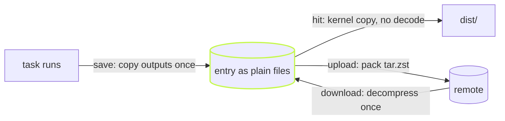

A build cache restores the same entry over and over. Switch branches
and back, delete `dist`, run CI's warm job again: it is the same bytes
each time. Until 0.0.644 vx stored every local entry as one `tar.zst`,
so every one of those hits paid to decompress and untar it again.

Now the archive exists only on the wire. The local cache keeps each
entry as its plain files, unpacked once when it is saved or downloaded,
and a hit copies them out.



## The kernel does the copy

A hit hands each file to the kernel: `copy_file_range` on Linux, or a
clone where the filesystem supports one (APFS on macOS, Btrfs or XFS on
Linux). A clone shares the file's blocks until one side writes, so a
large output can restore without copying its bytes.

vx never hard-links an output to the store. A hard link would be faster
still, but the restored file and the cached one would be the same inode.
A build that later edits `dist/index.js` in place would then edit the
cache, and the next hit would replay the edit. A copy or a clone keeps
the cache's version as it was.

On 1,000 entries of 96 KiB each, a full restore went from 1.26 s to
0.76 s (min of 5 runs, before and after the change, same machine).

## Small entries stay in the index

A thousand tiny outputs as a thousand directories is more file system
work than the bytes are worth. So an entry of up to 32 KiB stays inside
the cache index (SQLite) as one compressed row. The bound is a setting:

```ts
// .vx/workspace.ts
import { defineWorkspace } from '@vzn/vx/config'

export default defineWorkspace({
  cache: { store: { embeddings: '64KiB' } }, // false keeps every entry as files
})
```

If disk matters more than speed, `decompress: false` keeps each larger
entry as one `tar.zst` instead. That saves space, but every restore
decompresses it just in time.

## A local hit checks nothing

The first version of the file store checked each file's size and mtime
before a hit copied it out, and could hash every byte. We removed it.
The local store is vx's own directory: nothing else writes there, so the
check guarded against nothing, and every save had to read its outputs
back to record what the check compared. A local hit now copies the
stored files as they are.

Anything that crosses a network is still checked. A remote entry is a
`tar.zst` that ends with a CRC-32 over everything before it, checked
before the entry is used. A wrong sum is a miss, and the task runs.

## A download is decompressed once

A remote hit used to be written to a temp archive, decompressed once to
check it, then decompressed again to unpack it. Now a download of up to
4 MiB is fetched whole, decompressed once and written straight into the
store, where it is checked before anything points at it. A larger one
still goes through a temp file, decompressed once. Filling 200 tasks with 1 MB of output each from a
remote on the same machine went from 965 ms to 726 ms, and from a remote
30 ms away from 1,091 ms to 820 ms (min of 6 runs each).

The storage layout and every setting are in [Caching](../../caching/)
and the [schema](../../schema/). More on vx at
[vznjs.github.io/vx](https://vznjs.github.io/vx/).
