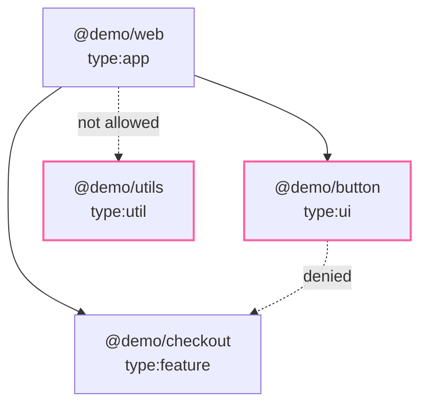

A UI kit that imports a checkout flow, or an app that reaches into a
helper it should not see, is easy to add and hard to remove. Tag the
layers, write the rules once, and `vx lock` holds every change to them.



## Tags and rules

A project names its tags in its own config:

```ts
// packages/button/vx.config.ts
import { defineProject } from '@vzn/vx/config'

export default defineProject({
  tags: ['type:ui'],
  tasks: { build: { exec: { command: 'tsc -b' } } },
})
```

The workspace says what each tag may depend on. A selector is
`tag:<glob>` or a project-name glob:

```ts
// .vx/workspace.ts
import { defineWorkspace } from '@vzn/vx/config'

export default defineWorkspace({
  run: {
    rules: {
      dependencies: [
        { from: 'tag:type:app', allow: ['tag:type:feature', 'tag:type:ui'] },
        { from: 'tag:type:ui', deny: ['tag:type:feature', 'tag:type:app'] },
      ],
    },
  },
})
```

A dependency must match one of `allow`, when it is given, and none of
`deny`. Every rule that selects a project applies, so a deny wins over
any allow. A project no rule selects is free.

## vx lock holds them

The rules are checked against each project's direct workspace
dependencies: its `package.json` and its cross-project `dependsOn`.
`vx lock` refuses a graph that breaks one, names every broken edge, and
writes nothing:

```sh frame="terminal"
$ vx lock
vx lock: .vx/lock.json not written: 2 dependencies break run.rules.dependencies:
  @demo/button depends on @demo/checkout, which run.rules.dependencies[1] (from 'tag:type:ui') denies
  @demo/web depends on @demo/utils, which run.rules.dependencies[0] (from 'tag:type:app') does not allow
Drop the dependency, or change the project's tags or the rule.
```

Drop the two edges and the lock is written:

```sh frame="terminal"
$ vx lock
vx lock: locked 4 project configs → .vx/lock.json

$ vx lock --check
vx lock --check: up to date (4 projects)
```

`vx lock --check` in CI fails the same way, so a pull request that adds
a forbidden dependency goes red. Runs never check these rules: under CI
they load configs from the lock, which already passed them
([Lock once, run frozen](../lock-and-frozen/)).

## From Nx

`nx()` from `@vzn/vx-migrate` reads the `depConstraints` of
`@nx/enforce-module-boundaries` in the root ESLint config and fills
`run.rules.dependencies` when the workspace sets none. It reads the file
and never runs it, so ESLint's plugins do not load on a vx run.

```js
// eslint.config.mjs (Nx)
depConstraints: [
  { sourceTag: 'type:app', onlyDependOnLibsWithTags: ['type:feature', 'type:ui'] },
  { sourceTag: 'type:ui', notDependOnLibsWithTags: ['type:feature'] },
]
```

becomes:

```ts
dependencies: [
  { from: 'tag:type:app', allow: ['tag:type:feature', 'tag:type:ui'] },
  { from: 'tag:type:ui', deny: ['tag:type:feature'] },
]
```

One difference: Nx's `@nx/enforce-module-boundaries`
[lint rule](https://github.com/nrwl/nx/blob/master/packages/eslint-plugin/src/rules/enforce-module-boundaries.ts)
checks source imports, while vx checks the dependencies a project
declares. `allSourceTags`, `/regex/` tags and constraints that only ban external
imports are left out; the
[vx-migrate README](https://github.com/vznjs/vx/tree/main/packages/vx-migrate#module-boundaries)
lists them. The schema is in the
[configuration reference](../../schema/).
