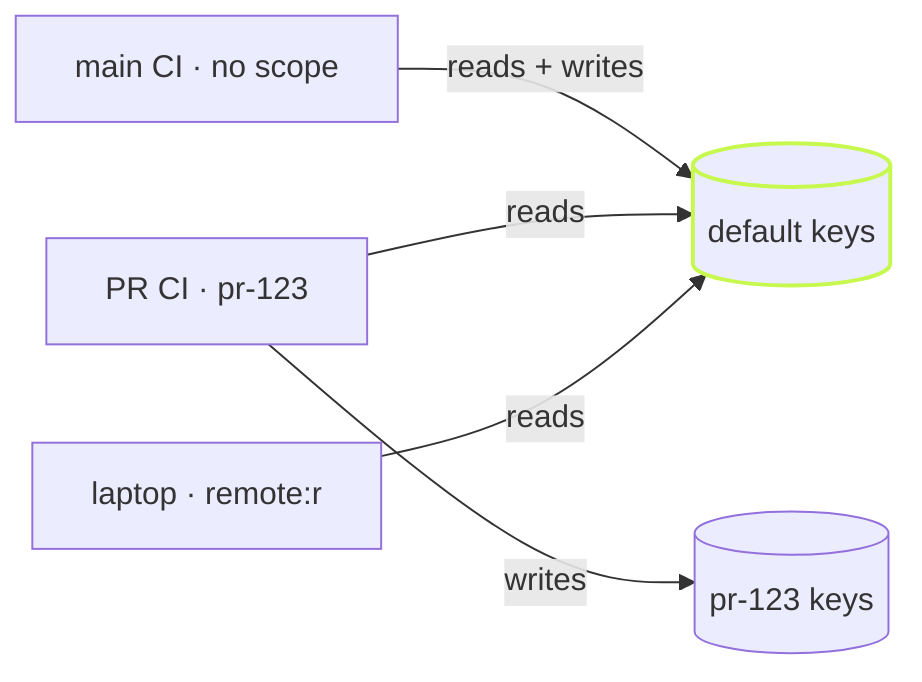

A cache is only useful when you can tell it what to do. vx gives you three
switches for a run, one store for every checkout, and a scope that keeps
untrusted runs from writing what everyone else reads.

## Three switches

```sh frame="terminal"
$ vx run build --all
  time      18ms
  result    4 tasks · all cached · 1.27s saved

$ vx run build --all --force
  time      658ms
  result    4 tasks · 0 cached (0%)

$ vx run build --all --no-cache
  time      638ms
  result    4 tasks · 4 no-cache
```

`--force` runs everything again and refreshes the cache with the result.
`--no-cache` neither reads nor writes. For finer control, `--cache-policy` takes
a read/write spec per layer:

```sh frame="terminal"
$ vx run build --all --cache-policy=local:rw,remote:r   # read the remote, never upload
$ vx run build --all --cache-policy=local:r             # read local, write nothing local
$ vx run build --all --cache-policy=local:,remote:rw    # skip local, still upload
```

`VX_CACHE_POLICY` sets the same spec for every run in a shell or CI job, and
`cache.policy` in `.vx/workspace.ts` sets the default; the flag beats the
variable, which beats the config. Whatever the spec, a lookup asks the
local cache first, then each remote in the order the plugins declare them.

```ts
// .vx/workspace.ts
import { defineWorkspace } from '@vzn/vx/config'

export default defineWorkspace({ cache: { policy: 'local:rw,remote:r' } })
```

An empty spec is refused, never read as "everything on":

```sh frame="terminal"
$ vx run build --all --cache-policy=
vx run: --cache-policy needs a spec like local:r, local:rw, remote:, or local:,remote:rw — pass --no-cache to disable every axis (see `vx run --help`)
```

## One store for every checkout

Artifacts live in `~/.vx/<id>/cache`, where the id comes from the repo's
remote. Each checkout keeps only its own small index. So a second clone
or a fresh `git worktree` hits what the first one built:

```sh frame="terminal"
$ git worktree add ../demo-wt && cd ../demo-wt
$ vx run build --all
  cache     ▰▰▰▰▰▰▰▰▰▰▰▰▰▰▰▰▰▰▰▰▰▰▰▰▰▰▰▰▰▰▰▰▰▰▰▰▰▰▰▰▰▰▰▰▰▰▰▰▰▰
            4 local
  time      22ms
  result    4 tasks · all cached · 1.24s saved
```

The new worktree had no `dist`. All four builds came back from the shared
store in 22ms. To put the cache somewhere else, use `--cache-dir`,
`VX_CACHE_DIR` or `cache.dir` in `.vx/workspace.ts`.

## Who may write the remote cache

A remote cache is shared, so a write is a promise to everyone who reads
it. `cache.scope` decides where a run's writes land:



- With no scope, a run reads and writes the default keys.
- A scope, like `pr-123`, reads the default keys first, then its own,
  and writes only its own. A pull request never writes what main reads.
- Whether a run writes at all is the policy's call. Off CI the default
  reads the remote and writes nothing.

```sh frame="terminal"
$ vx run build --cache-scope pr-123
```

`--cache-scope` beats `VX_CACHE_SCOPE`, which beats `cache.scope` in
`.vx/workspace.ts`. On GitHub Actions, the
[@vzn/vx-ci plugin](https://vznjs.github.io/vx/blog/results-on-github/)
sets the scope for you: `pr-<n>` on a pull request, none on the
default branch. The scope is a client-side rule, so a cache server that
checks tokens is still the real boundary.

Every flag is in the [CLI reference](../../cli/), and `cache` is in
the [schema](../../schema/).
