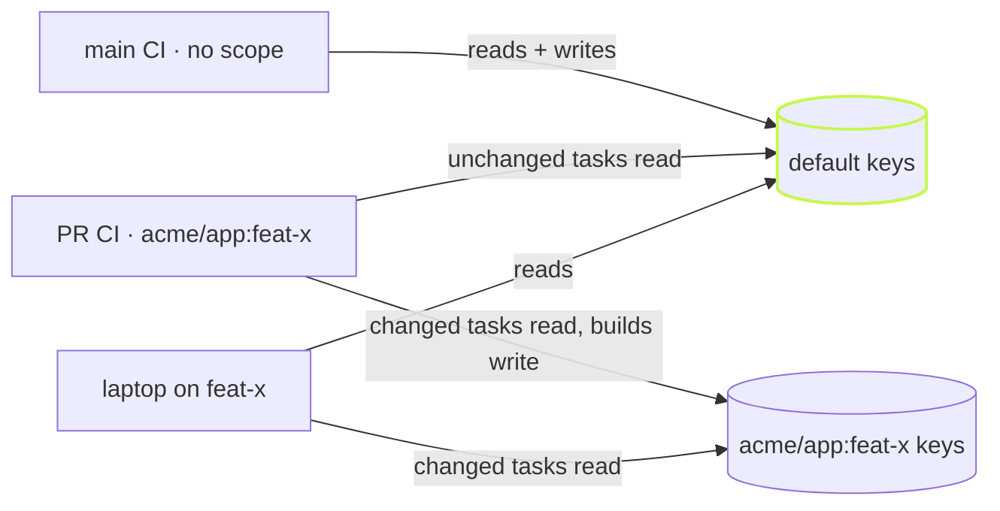

A cache is only useful when you can tell it what to do. vx gives you three
switches for a run, one store for every checkout, and a scope that keeps
untrusted runs from writing what everyone else reads.

## Three switches

```sh frame="terminal"
$ vx run build --all
  time      18ms

$ vx run build --all --force
  cache     local 4↑
  time      658ms

$ vx run build --all --no-cache
  cache     local 4∅
  time      638ms
```

`--force` runs everything again and saves what the cache lacks. A key
already stored, locally or in a remote, is kept as it is and not
uploaded again.
`--no-cache` neither reads nor writes. For finer control, `--cache-policy` takes
a read/write spec per layer:

```sh frame="terminal"
$ vx run build --all --cache-policy=local:rw,remote:r   # read the remote, never upload
$ vx run build --all --cache-policy=local:r             # read local, write nothing local
$ vx run build --all --cache-policy=local:,remote:rw    # skip local, still upload
```

`VX_CACHE_POLICY` sets the same spec for every run in a shell or CI job, and
`cache.policy` in `.vx/workspace.ts` sets the default; the flag beats the
variable, which beats the config. Whatever the spec, a lookup asks the
local cache first, then each remote in the order the plugins declare them.

```ts
// .vx/workspace.ts
import { defineWorkspace } from '@vzn/vx/config'

export default defineWorkspace({ cache: { policy: 'local:rw,remote:r' } })
```

An empty spec is refused, never read as "everything on":

```sh frame="terminal"
$ vx run build --all --cache-policy=
✗ vx run  --cache-policy needs a spec like local:r, local:rw, remote:, or local:,remote:rw — pass --no-cache to disable every axis

  see vx run --help
```

## One store for every checkout

Artifacts live in `~/.vx/<id>/cache`, where the id comes from the repo's
remote. Each checkout keeps only its own small index. So a second clone
or a fresh `git worktree` hits what the first one built:

```sh frame="terminal"
$ git worktree add ../demo-wt && cd ../demo-wt
$ vx run build --all
  cache     ▰▰▰▰▰▰▰▰▰▰▰▰▰▰▰▰▰▰▰▰▰▰▰▰▰▰▰▰▰▰▰▰▰▰▰▰▰▰▰▰▰▰▰▰▰▰▰▰▰▰
            local 4↓
  time      22ms
```

The new worktree had no `dist`. All four builds came back from the shared
store in 22ms. To put the cache somewhere else, use `--cache-dir`,
`VX_CACHE_DIR` or `cache.dir` in `.vx/workspace.ts`.

## Who may write the remote cache

A remote cache is shared, so a write is a promise to everyone who reads
it. Two settings decide it. The policy says whether a run writes at
all: off CI the default reads the remote and writes nothing. The scope
says where a branch's remote entries live:



- On the default branch, a run reads and writes the default keys.
- On another branch, the scope is `<owner>/<repo>:<branch>`. Each task
  asks the remote one key: a task the branch changed reads the scope's,
  every other task reads main's. A pull request never writes what main
  reads.
- The local cache never knows a scope. What a laptop fetches under a
  branch's scope it keeps under the task key, so the same inputs hit
  locally on any branch.

On GitHub Actions the
[@vzn/vx-ci plugin](../results-on-github/)
names the scope for you, and a checkout with a remote cache derives the
same one from `.git`, so a laptop reads what CI built
there. The scope is a client-side rule, so a cache server that
checks tokens is still the real boundary.

Every flag is in the [CLI reference](../../cli/), and `cache` is in
the [schema](../../schema/).
