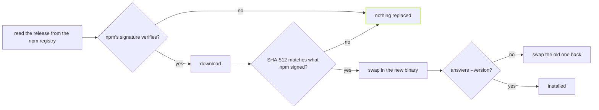

A tool that replaces itself has one job to get right: never leave you
with a broken binary, or a binary someone else built. `vx upgrade` is
careful about both.



## One command

```sh frame="terminal"
$ vx upgrade            # the latest release
$ vx upgrade v0.4.0     # a specific one
```

What it guards against:

- The release must carry npm's registry signature over its name, version
  and SHA-512, checked against npm's key, which vx pins. The server that
  hands out the file cannot make that signature, so a swapped file is
  refused. So is a signature from a key vx does not know, with a note that
  vx itself needs updating.
- The download must match the SHA-512 npm signed. Nothing is written
  until both checks pass.
- The new binary must answer `--version` within 10 seconds. One that
  does not start on this machine is swapped back, and the command exits 1.
- A folder you cannot write, such as a root-owned `/usr/local/bin`, is
  refused before anything downloads, with the `sudo` line to run instead.
- No network, a dead proxy, or a captive portal's page is one line that
  says nothing was replaced, never a stack trace.
- On the version it already is, it says `already at <version>` and
  downloads nothing.

Installed with a package manager? Then that package manager owns the
file, so `vx upgrade` asks it to do the upgrade and prints the command it
runs: `npm install -g`, `pnpm add -g`, `bun add -g` or `yarn global add`
for a global install, and the project's own manager for a dependency, so
`package.json` and the lockfile change together:

```sh frame="terminal"
$ vx upgrade
vx upgrade: 0.0.635 → 0.0.640: running pnpm add @vzn/vx@0.0.640 --save-dev (in /repo)
```

vx never installs Node or a package manager for you.

## Who built the bytes

npm's signature proves these are the bytes npm's registry received.
It does not say who built them. For that, every release binary
carries a Sigstore-signed build-provenance attestation naming the
repository, commit and CI workflow that built it:

```sh frame="terminal"
$ gh attestation verify vx-linux-x64 --repo vznjs/vx
```

npm packages are published from CI through trusted publishing, with
provenance attached, so no long-lived npm token exists to steal.

## A CLI that does not guess

Numbers are strict. `0x10`, `1e3` and `2.7` are refused, never read as
something you did not mean, and an old flag names its new one:

```sh frame="terminal"
$ vx run build --concurrency 0x10
vx run: --concurrency must be a positive integer, or a share of the cores like '50%' (got 0x10) (see `vx run --help`)

$ vx run build --timeout 1e3
vx run: --timeout must be a duration like '500ms', '30s' or '5m', at most 24 days (got 1e3) (see `vx run --help`)

$ vx run build --retry 2
vx run: --retry was renamed --retries (a non-negative integer) in vx 0.0.637 (see `vx run --help`)
```

`vx help` lists every verb, `vx help <verb>` shows one, and `vx version`
prints the version. The full reference is the [CLI page](../../cli/).
