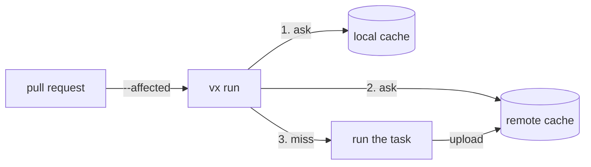

import { Steps, Tabs, TabItem, Aside, CardGrid, LinkCard } from '@astrojs/starlight/components'

Run what a change touched, and reuse what another machine already built.



## Run and filter

`vx run build` runs `build` in the package you are in, and what it
depends on. From the root, say which packages:

```bash
vx run build --all                     # every package that has build
vx run build --filter "@app/*"         # packages whose name matches
vx run build --filter "...@app/ui"     # a package and everything that depends on it
vx run test --affected                 # changed since the base branch, and dependents
vx run test --affected=origin/main     # changed since that ref
vx run app#build api#test              # exact tasks, from anywhere
vx run lint test build --all           # several tasks, one graph
vx run test --all -- --bail            # the child runs: bun test --bail; the key sees it
vx run build --all --dry               # the plan, nothing runs
vx watch test --all                    # re-run whenever its files change
```

`--dry` prints what would run and where each result would come from:

```text
would run:
  ✓  @acme/api#build  cache hit (local)         8625b603
  ✓  @acme/ui#build   cache hit (local)         71e5d9a0
  ✓  @acme/web#build  cache hit (local)         42e9b39d

3 task(s) planned, 3 cache hits (3 local).
```

| Flag                | Does                                                        |
| ------------------- | ----------------------------------------------------------- |
| `--no-cache`        | ignore the cache: no reads, no writes                       |
| `--force`           | run everything; save only what the cache lacks              |
| `--concurrency <n>` | at most n tasks at once (default: the cores you may use)    |
| `--continue`        | keep going after a failure ([modes](../configure/#tasks-and-dependencies)) |
| `--output-logs <m>` | `full`, `errors-only`, `hash-only` or `none`                |

A bare `--affected` compares with the merge base off your base branch;
`VX_AFFECTED_BASE` names another commit. Every flag: [the CLI reference](../../cli/).

## GitHub Actions

### 1. Add the workflow

```yaml
# .github/workflows/ci.yml
name: ci
on:
  pull_request:
  push:
    branches: [main]
jobs:
  ci:
    runs-on: ubuntu-latest
    permissions:
      contents: read # checkout; naming any permission drops the rest
      checks: write # the PR check github() posts
    steps:
      - uses: actions/checkout@v4
        with:
          fetch-depth: 0 # --affected needs the history
      - uses: oven-sh/setup-bun@v2
      - run: bun add -g @vzn/vx # hands off to the repo's own vx
      - run: bun install --frozen-lockfile
      # A lock that no longer matches the configs fails here, before any task.
      - run: vx lock --check
      # main runs everything and fills the cache every pull request
      # reads; a pull request runs only what it changed, and what depends on it.
      - run: >
          vx run ci
          ${{ github.event_name == 'pull_request'
            && format('--affected=origin/{0}', github.base_ref)
            || '--all' }}
        env:
          GITHUB_TOKEN: ${{ github.token }} # the PR check
          VX_REAPI_ENDPOINT: ${{ vars.VX_REAPI_ENDPOINT }}
          VX_CACHE_TOKEN: ${{ secrets.VX_CACHE_TOKEN }} # read-write
```

### 2. Declare the plugins

```ts
// .vx/workspace.ts
import { defineWorkspace } from '@vzn/vx/config'
import { github } from '@vzn/vx-ci'
import { npm } from '@vzn/vx-lockfile'
import { reapi } from '@vzn/vx-reapi'

const token = process.env.VX_CACHE_TOKEN

export default defineWorkspace({
  plugins: [
    // The package edges `^build` follows, from package-lock.json.
    npm(),
    // On Actions: the job summary, the PR check, and the PR's base for --affected.
    github(),
    // The shared cache. With no VX_REAPI_ENDPOINT it declines and vx
    // caches on this machine alone.
    reapi({ headers: token ? { authorization: `Bearer ${token}` } : {} }),
  ],
})
```

### 3. Push

A push to `main` runs `--all` and fills the cache. A pull request runs
`--affected=origin/<base>`: what it changed, and what depends on that.


Both files are [`examples/ci`](https://github.com/vznjs/vx/tree/main/examples/ci);
vx's own CI runs their steps on every commit.

`github()` writes a job summary, failures first, and a PR check. The check
needs `GITHUB_TOKEN` in the vx step's `env`, as above; without it the check
is skipped and the summary still writes. Outside GitHub Actions it
declines. A test renders this sample:

> ## ❌ vx run
>
> **5** tasks · **2** executed · **2** cache hits (1 up-to-date, 1 restored, 1 from remote) · **1** failed · 21.4s
>
> ### Failures
>
> - **@acme/web#build** — exit 2
>
> | Task | Status | Duration |
> | --- | --- | --- |
> | @acme/web#build | ❌ failed | 3.1s |
> | @acme/web#test | ✅ ran | 4.2s |
> | @acme/api#build | ☁️ restored remote | 0ms |
> | @acme/ui#build | ✔️ up-to-date | 0ms |
> | @acme/ui#lint | ⏭️ skipped | 0ms |
>
> <sub>vx 0.0.21 · `vx run ci --all` · 3/5 passed · 1 up-to-date · 1 restored</sub>

A failure on inputs that passed before says so on its row:

```
 ◼︎   4.21s failed  miss     web#test flaky - passed 3× before
```

### When to run vx lock

`vx lock` writes each project's resolved config to `.vx/projects.lock.json`,
and refuses a graph that breaks a `run.rules` rule (two tasks writing one
output, an input that reads another task's output); commit it. Every run
reads its configs from the lock, so after a change the runs keep the old
configs until you run `vx lock` again; with no lock a run fails with
`` no lock: run `vx lock` ``. Run it after you:

- edit any `vx.config.ts` or `.vx/workspace.ts`,
- update dependencies or plugins,
- change a file a config imports.

`vx lock --check` evaluates every config again and fails on any difference
or broken rule, naming the project, so it is the workflow's first step.

### Skip a deploy nothing changed

`vx show --affected --format json` lists the packages a change reaches.
Deploy an app only when it is in that list:

```yaml
      - id: web
        run: |
          vx show --affected --format json \
            | jq -e 'any(.[]; .name == "@acme/web")' > /dev/null \
            && echo changed=true >> "$GITHUB_OUTPUT" || echo changed=false >> "$GITHUB_OUTPUT"
      - if: steps.web.outputs.changed == 'true'
        run: vx run @acme/web#deploy
```

`jq -e` exits 1 when the app is not listed, and nothing affected lists
`[]`. Give it the same `--affected=<ref>` as the run.

### Common problems

- **`--affected has no base here … a shallow clone?`** Set `fetch-depth: 0`.
- **`nothing affected since <ref>` on every push.** `origin/main` on a push to `main` is the commit itself. Use `github.event.before`.
- **The whole log lands in the job summary.** Don't redirect vx's output there; declare `github()` from `@vzn/vx-ci`, which writes the summary.

## GitLab CI

`gitlab()` from `@vzn/vx-ci` does on GitLab what `github()` does for the
base and the cache scope:

```ts title=".vx/workspace.ts"
import { defineWorkspace } from '@vzn/vx/config'
import { gitlab } from '@vzn/vx-ci'

export default defineWorkspace({ plugins: [gitlab()] })
```

A merge request pipeline is compared with the merge request's diff base,
so a bare `--affected` needs no history beyond that commit, and
`turboCache()` reads the source branch, then the target. Plugin entries
are scoped `<project path>:<branch>` off the default branch and merge
trains; `gitlab({ cacheScope: false })` turns that off. It writes no merge
request comments or reports yet.

## Remote cache

A shared cache is a plugin. vx looks here first, then asks the remote, and
uploads new results in the background.

<Tabs>
  <TabItem label="Bazel REAPI">
    ```ts title=".vx/workspace.ts"
    import { defineWorkspace } from '@vzn/vx/config'
    import { reapi } from '@vzn/vx-reapi'

    export default defineWorkspace({
      plugins: [reapi({ endpoint: 'grpcs://cache.example.com:443' })], // or VX_REAPI_ENDPOINT
    })
    ```

    `@vzn/vx-reapi` speaks Bazel's Remote Execution API (NativeLink,
    BuildBuddy, Buildbarn, bazel-remote). It re-hashes every blob it reads:
    a corrupt download, a down server or a refused token is a miss, never
    wrong bytes. With no endpoint, it declines.
  </TabItem>
  <TabItem label="Turborepo / Vercel">
    ```sh
    bun add -d @vzn/vx-migrate
    bunx turbo login && bunx turbo link        # stores a token and a team
    export TURBO_TOKEN=… TURBO_TEAM=…
    ```

    Then declare `plugins: [turboCache()]` from `@vzn/vx-migrate`. It keeps
    a Turborepo cache, Vercel's included, and reads Turbo's own variables.
    On GitHub Actions, `turboCache({ oidc: true })` needs no stored token:
    with `permissions: id-token: write` it exchanges the job's OIDC token
    for a short-lived one and revokes it when the run ends. A fork's or
    Dependabot's pull request gets no OIDC token, so its runs stay local.
  </TabItem>
  <TabItem label="Nx">
    `nxCache()` from `@vzn/vx-migrate` does the same for a self-hosted Nx
    cache.
  </TabItem>
  <TabItem label="Your own">
    Any backend is [a plugin](../plugins/#your-own-cache).
  </TabItem>
</Tabs>

A laptop needs no variable: with the URL or team known and no token, the
first run in a terminal asks for one and keeps it in the OS keychain. On
CI a missing token is one warning and a local-only run, never a failure;
`--cache-policy=remote:` skips the remote and the question.

vx's policy alone decides what a run writes: the plugins do not read
Turbo's `TURBO_REMOTE_CACHE_READ_ONLY` or `TURBO_CACHE`, or Nx's
`NX_SKIP_REMOTE_CACHE`.

| Where | Default `cache.policy` | Token |
| --- | --- | --- |
| CI (`CI` set) | every layer reads and writes | read-write, a repository secret |
| a laptop | `local:rw,remote:r` | read-only, in `VX_CACHE_TOKEN` |

<Aside type="caution" title="The write token is the boundary">
  A run holding a write token can write wherever the server lets it. Give
  write tokens only to CI you trust; a job you do not trust sets
  `--cache-policy=local:rw,remote:r`. A pull request from a fork gets no
  secrets, so it runs without one ([security](../../security/#cache-poisoning)).
</Aside>

### Cache scopes and tokens

A task key carries no branch, and the client never says where a write
lands. The cache server decides: the CI OIDC token, checked against the
server's trust policy, sends a write to the trusted cache, to its own
branch's, or nowhere. No header, key or option changes that.

`turboCache()` only steers reads. Every read names the run's refs, own
branch first, in `x-artifact-read-scopes`, and the server answers from the
first that holds the key:

| Run | `x-artifact-read-scopes` |
| --- | --- |
| push to `main` | `refs/heads/main` |
| pull request from `feat-x` | `refs/heads/feat-x, refs/heads/main` |
| merge queue | `refs/heads/gh-readonly-queue/main/…, refs/heads/main` |
| laptop on `feat-x` | `refs/heads/feat-x, refs/heads/main` |

CI's refs come from its env, a laptop's from git (the current branch, then
`origin/HEAD`'s), so `git checkout feat-x` reads what CI built for
`feat-x`. A server that ignores the header keeps one shared cache. For one
like that (Vercel), `turboCache({ scope: 'key' })` folds the ref into each
key: a run writes under its own ref's key and asks every ref's key in one
batch, first hit wins. That keeps branches apart but does not secure them:
any writer can compute `main`'s key. The local cache never knows a branch:
back on `main`, the same inputs hit locally.
[Branch caches a server enforces](../../blog/branch-caches-a-server-enforces/)
shows how a server implements the header. `nxCache()` sends plain requests.

## Remote execution

`reapi()` can also send tasks to a worker pool (NativeLink, BuildBuddy,
Buildbarn); the graph and the scheduling stay here. It is never on by
default:

```ts title=".vx/workspace.ts"
import { defineWorkspace } from '@vzn/vx/config'
import { reapi } from '@vzn/vx-reapi'

export default defineWorkspace({
  plugins: [
    reapi({
      endpoint: 'grpcs://cache.example.com:443',
      execute: true, // or VX_REAPI_EXECUTE=1
      platform: { OSFamily: 'Linux', 'container-image': 'docker://node:22' },
      capacity: 64, // remote tasks at once, apart from your cores
    }),
  ],
})
```

`--dry` says where each task runs (`@vx/reapi` or `@local`).

- `exec.remote: false`, sandboxed and persistent tasks, and what depends
  on them, stay here. A task with no `cache` block stays here too, but what
  depends on it can still go remote.
- Workers have no `node_modules`: make the install a `remote: 'only'` task
  the others depend on. The image needs `/bin/sh` and your toolchain.
- A worker gets only what `inputs` declares, so a task that fails there
  and passes here reads a file it never declared.
- A down server is a cache miss, never a hung run.
- Uploads chunk at 65535 bytes (`SAFE_CHUNK_BYTES`), the size no Bun http2
  stall has been seen at. A larger `chunkBytes` that stalls retries once at
  that size before the task fails.

## Next

<CardGrid>
  <LinkCard title="Plugins" description="Write your own cache, executor or sink." href="../plugins/" />
  <LinkCard title="Every CLI flag" description="The full command reference." href="../../cli/" />
</CardGrid>
