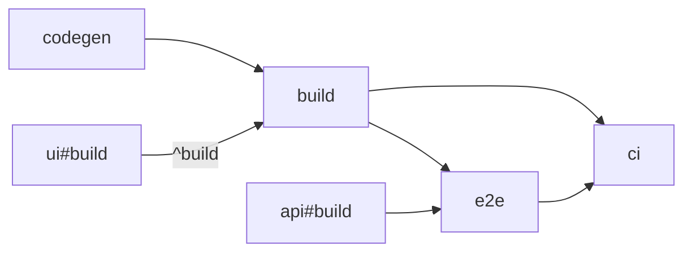
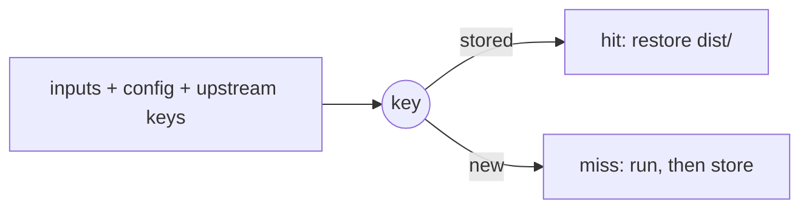

import { Steps, Tabs, TabItem, Aside, CardGrid, LinkCard, FileTree } from '@astrojs/starlight/components'
import GraphExplorer from '../../../components/demos/GraphExplorer.astro'

Tell vx what each task runs, what it reads and what it writes. vx does the
rest: it runs tasks in order, in parallel, and skips any task whose inputs
have not changed.

<FileTree>
- .vx/
  - workspace.ts the workspace: plugins and settings
  - projects.lock.json written by `vx lock`, read by every run
- packages/
  - app/
    - vx.config.ts one per project: its tasks
    - src/
  - ui/
    - vx.config.ts
</FileTree>

A project is any directory with a `vx.config.ts`, in any language. Its
name is the config's `name`, else a plugin's (`@vzn/vx-lockfile` gives
the `package.json` name), else its path (`apps/web`; `//` for the root).

<Aside type="caution" title="Run `vx lock` after every config change">
  Runs read configs from `.vx/projects.lock.json`, never from the files.
  After you add or edit a `vx.config.ts`, run `vx lock` and commit the lock.
</Aside>

## Tasks and dependencies

A task is one shell command. `dependsOn` says what must finish first.

```ts title="packages/app/vx.config.ts"
import { defineProject } from '@vzn/vx/config'

export default defineProject({
  tasks: {
    codegen: {
      exec: { command: 'graphql-codegen' },
      inputs: { files: ['schema.graphql'] }, cache: { outputs: { files: ['src/gen/**'] } },
    },
    build: {
      description: 'compile TypeScript to dist/',
      dependsOn: ['codegen', '^build'],
      exec: { command: 'tsc -b' },
      // codegen's output reaches this key through codegen's own key; a key
      // that read it could not be known until codegen ran, so vx refuses it.
      inputs: { files: ['src/**', '!src/gen/**'] }, cache: { outputs: { files: ['dist/**'] } },
    },
    e2e: {
      dependsOn: ['build', 'api#build'],
      exec: { command: 'playwright test', timeout: '10m', retries: 1 },
    },
    // A group: no command, it only runs its dependencies.
    ci: { dependsOn: ['build', 'e2e'] },
  },
})
```



| `dependsOn`   | Runs first                                                        |
| ------------- | ----------------------------------------------------------------- |
| `'build'`     | `build` in this package                                           |
| `'^build'`    | `build` in each package this one depends on ([a lockfile plugin's edges](#lockfiles)) |
| `'api#build'` | `build` in the `api` package                                      |
| `'build.*'`   | every task in this package whose name matches                     |

A task-name pattern is allowed: `dependsOn: ['build.*']`, or `'^build.*'`.
Bare wildcards and negation (`*`, `!task`) are not.
A cycle or a missing `'pkg#task'` is an error.

### Explore your graph

See what each task waits on and what waits on it, in your own repo:

```sh
vx run build --all --dry=json > plan.json
```

Drop `plan.json` below, or paste it, then type a task. Nothing is uploaded.

<GraphExplorer />

<Aside title="A package with no build">
  A package that declares no `build` gets a default one: a group behind
  `^build`, keyed on all its files, so editing a package consumed as source
  re-runs its dependents. `vx show` lists it as a group.
</Aside>

When a task fails:

| Flag | vx |
| ---------------------------- | --------------------------------------------------------- |
| `--continue=deps-ok` (default) | skips its transitive dependents and runs the rest       |
| `--continue=never`           | stops at the first failure                                |
| `--continue=always`          | runs the dependents, but saves none of them               |

<details>
<summary>Every <code>exec</code> field</summary>

| Field             | Does                                                          |
| ----------------- | ------------------------------------------------------------- |
| `exec.command`    | the one shell command, run in the package's directory (chain steps with `&&`) |
| `exec.env`        | what the command sees ([below](#environment-variables))       |
| `exec.timeout`    | kill the task after this long                                 |
| `exec.retries`    | re-run a failed task this many times                          |
| `exec.persistent` | a server or watcher that does not exit ([below](#dev-tasks))  |
| `exec.sandbox`    | only the declared files and network ([Sandboxing](../sandboxing/)) |
| `exec.interactive` | reads the terminal: a prompt, a REPL, a TUI; runs alone, never cached |
| `exec.remote`     | `false` keeps it here; `'only'` for a remote pool ([Remote execution](../ci/#remote-execution)) |

`exec.remote` is the one `exec` field stripped from the key: where a task
ran says nothing about what it made. The rest is in the key, `description`
included, so editing a description costs one re-run.

</details>

## Caching

A task with a `cache` block runs once per set of inputs. List what the
command reads under `inputs`, and what it writes under `cache.outputs`
(`[]` for test or lint).

```ts title="packages/app/vx.config.ts" {9-14,16-18}
import { defineProject } from '@vzn/vx/config'

export default defineProject({
  tasks: {
    build: {
      dependsOn: ['^build'],
      exec: { command: 'vite build', env: { passThrough: ['NODE_ENV'] } },
      inputs: {
        files: ['src/**', 'index.html', '!**/*.test.ts'],
        env: ['NODE_ENV'],
        workspaceFiles: ['tsconfig.base.json'], // from the workspace root
      },
      cache: {
        outputs: { files: ['dist/**'] },
      },
    },
  },
})
```



<Aside type="tip" title="Not sure the list is complete?">
  Add [`exec.sandbox`](../sandboxing/) with `allow.read` listing the same
  files. A workspace read outside it fails the task and names the file.
</Aside>

A task with no `cache` block is keyed on its `inputs` all the same, so a
cached task behind it re-runs when they change. One that declares no
`inputs` has no key, and every task behind it misses.

<details>
<summary>What the key holds</summary>

| The key                | Holds                                                                                   |
| ---------------------- | --------------------------------------------------------------------------------------- |
| Always in it           | the keys of the tasks it depends on, the task's config, arguments after `--` |
| In, with a lockfile plugin | the package's `package.json` and its own dependencies from the lockfile ([Lockfiles](#lockfiles)) |
| Always excluded        | an untracked `node_modules` git does not ignore (an install), `.git`, `.vx/cache`, `.vx/projects.lock.json`, `vx.lock.json`, `.vx/.gitattributes`, `.vx/.gitignore`, `.vx/tmp` (restore staging), each at the project's root only, the task's own outputs, a nested project's files |
| Excluded unless named  | files git ignores, an ignored `node_modules` included: a broad glob like `src/**` skips them, an exact path or a glob whose fixed part git ignores (`.env.local`, `node_modules/.prisma/client/**`) keys them |
| In, when you say so    | a tool's version: `inputs.workspaceRuntime: ['node -v']` runs once per run at the root and folds its output; `runtime` runs in the package |
| Out, when you say so   | a dependency only for order: `inputs.tasks: []`, as the [dev task](#dev-tasks) does |

Every part, in order: [Caching in depth](../../caching/).

</details>

What happens to outputs:

- Declared outputs are wiped before every run that writes the cache.
- A hit rewrites only the files that differ from the entry, then removes
  the ones it does not hold, so `dist/` ends as the cache stored it. A
  hit that finds them already as stored writes nothing.
- A restore writes only files the task's `cache.outputs` declare.
- A failed task is never saved.
- `--force` runs and refreshes the cache; `--no-cache` ignores it.

### Why did it re-run?

```sh
vx why app#build
```

```console
app#build — run 01a1660e-824d-77ed-a045-d5a178ffd67b
  this run   2026-10-22T23:59:49.365Z · success · executed · key d0c31c5d5d1f9f67
  previous   2026-10-22T23:59:49.110Z · success · key 5b1057fc68216f54
  verdict    cache key changed: file packages/app/src/index.ts

  what changed (1 component, 2 unchanged):
    changed file  packages/app/src/index.ts  41715495f45f651e6cf7d38f58a3d512abcfa440 → a853d874fb63b83b04ebb3ce1a2f516c4c41eee8

  what to do:
    file  an edit re-runs by design; a file the task does not read belongs out of inputs.files
```

A hit after you changed something means that something is not declared.

<details>
<summary>Every verdict <code>vx why</code> prints</summary>

| The verdict line says | It means |
| --- | --- |
| `cache key changed: env MODE, file packages/app/src/index.ts` | those inputs moved (three named, then a count); the lines below show each |
| `cache key changed between the previous run and this one (inputs differ)` | the key moved and neither entry kept its components (pruned, or a failed run saved none) |
| `` never cached: this task declares no `inputs`, so each run derives a new key; declare its `inputs` `` | the task itself declares no `inputs`, so its key is new every run |
| `` never cached: its key folds //#stamp, which declares no `inputs`, so each run derives a new key; declare inputs on //#stamp `` | a task this key folds declares no `inputs`, so the key is new every run; declare them on that task |
| `cache key unchanged — this run was served from cache, nothing re-ran` | a hit |
| `cache key unchanged — the previous run on this key failed and saved nothing, so there was nothing to hit` | a failure saves no entry |
| `cache key unchanged — re-executed because this run did not read the cache (--force, or a --cache-policy without read)` | the run's policy read no cache |
| `cache key unchanged — neither run saved it: each ran beside a failed task (…), and a task run past a failed dependency (--continue) is never cached` | both runs went past a failure under `--continue` |
| `cache key unchanged — the previous run on this key ran beside a failed task (…) and was not saved: a task run past a failed dependency (--continue) is never cached, so there was nothing to hit` | the previous run went past a failure under `--continue` |
| `cache key unchanged — no entry for this key was in the cache when it ran (pruned or evicted), so it executed and saved one` | the entry was gone |
| `cache key unchanged — the previous run on this key executed but no entry for it is in the cache (its save failed, or it was pruned since), so there was nothing to hit` | the previous run's save failed, or a prune took the entry |
| `cache key unchanged — the previous run on this key did not write the cache (--no-cache, or a --cache-policy without write), so there was nothing to hit` | the previous run's policy wrote no cache |
| `cache key unchanged — re-executed on the same key though this run read the cache; vx cannot name the cause` | none of the above; vx cannot name the cause |
| `cache key unchanged — re-executed on the same key (--no-cache / --force, or unrelated)` | no invocation recorded this run's cache policy, so vx cannot rule the flags out |
| `cache key unchanged — this run recorded no cache outcome, so whether it re-ran is unknown` | vx does not guess |
| `` this task declares no `cache` block — it runs on every invocation; its key is folded by dependents only `` | not cached at all |
| `this task recorded no cache key (skipped, or a persistent task) — nothing to compare` | no key to compare |
| `no prior run for this (project, task)` | nothing to compare with yet |

</details>

## Environment variables

Past a small essential allowlist (below), a task sees only the variables
you pass it.

| List                   | The command sees it | The key sees it | Use it for                                          |
| ---------------------- | ------------------- | --------------- | --------------------------------------------------- |
| `exec.env.passThrough` | yes                 | no              | secrets and CI flags (`GITHUB_ACTIONS`, `GH_TOKEN`); stays on this machine |
| `inputs.env`     | no                  | yes             | with `passThrough`: a variable that changes the output |
| `exec.env.define`      | yes                 | yes             | a literal value; a remote task gets it too          |
| `exec.env.secret`      | —                   | —               | names whose values (6 characters or more) print as `***`; names holding `TOKEN`, `SECRET`, `KEY`, `PASSWORD`, `PASSWD` or `CREDENTIAL` are masked without it |

<details>
<summary>What every task gets</summary>

Every task always gets a small essential allowlist so normal CLI tools
work: `PATH`, `HOME`, `SHELL`, `USER`, `LOGNAME`, `TMPDIR`, `TEMP`, `TMP`, `LANG`, `LC_ALL`,
`LC_CTYPE`, `TERM`, `COLORTERM`, `FORCE_COLOR`, `NO_COLOR`, `CI`,
`NODE_OPTIONS`, `COREPACK_HOME`, `PNPM_HOME`. vx sets `VX_RUN_WORKSPACE` (the workspace root) and `VX_RUN_TASK`
(the `project#task` running) on every task, and `npm_execpath` to the
workspace's package manager, so a tool that calls it back finds it. The package's `node_modules/.bin` is first on `PATH`. What vx
itself reads: [the CLI reference](../../cli/#environment-variables-vx-reads).

</details>

## Dev tasks

A `persistent` task is a server or watcher. Its dependents start once it
prints a line matching `readyWhen`; if none comes, `exec.timeout` fails it.

```ts title="packages/web/vx.config.ts"
import { defineProject } from '@vzn/vx/config'

export default defineProject({
  tasks: {
    dev: {
      exec: { command: 'vite', persistent: { readyWhen: 'Local:' }, timeout: '30s' },
    },
    e2e: {
      dependsOn: ['dev'],
      exec: { command: 'playwright test' },
      inputs: { files: ['e2e/**'], tasks: [] }, // dev is for order, not the key
      cache: { outputs: { files: ['playwright-report/**'] } },
    },
  },
})
```

When the run ends, vx sends the server `SIGTERM`; one still alive after a
2-second grace is `SIGKILL`ed. A persistent task has no `cache` block. A sandboxed server
on Linux lists its port in `sandbox.allow.localBinding`.

## Workspace config

`.vx/workspace.ts` is required: the nearest one up from where you run,
within your git checkout, marks the workspace root (`vx init` writes it).
With no plugins in it, vx runs and caches on this machine.

```ts title=".vx/workspace.ts"
import { defineWorkspace } from '@vzn/vx/config'
import { reapi } from '@vzn/vx-reapi'

export default defineWorkspace({
  plugins: [reapi({ endpoint: 'grpcs://cache.internal:443' })],
  run: {
    concurrency: 8, // default: usable cores
    timeout: '10m', // default: none
  },
  cache: {
    dir: 'build/.vx', // unset: entries shared by this repo's checkouts in ~/.vx/<id>/cache
  },
})
```

Each setting has one path, and its variable and flag come from it:
`run.timeout` is `VX_RUN_TIMEOUT` and `vx run --timeout`. A flag beats the
variable, which beats this file. Durations and sizes carry a unit
(`'30s'`, `'10m'`, `'32KiB'`). All of them: [the settings table](../../schema/#settings).

<details>
<summary>The fields you will reach for</summary>

| Field            | Sets                                                                  |
| ---------------- | --------------------------------------------------------------------- |
| `plugins`        | asked in order; this machine runs what they decline, and its cache is asked first ([Plugins](../plugins/)) |
| `run.concurrency` | tasks at once, a number or a share of the cores (`'50%'`) |
| `run.timeout`, `run.retries` | a task's time limit and re-runs, for tasks without their own `exec.timeout` / `exec.retries` |
| `baseBranch` | the default branch, by name; default `origin/HEAD`'s branch, then `main`, then `master`. A bare `--affected` compares with its merge base off it, and on it has no default unless `VX_AFFECTED_BASE` names one |
| `run.schedule` | which ready task starts first: `'most-work'` (default, most tasks waiting behind it), `'critical-path'` (longest chain), `'direct-dependents'`, `'ready-order'`; a `schedule` plugin's weights come first ([Blog](../../blog/scheduling-strategies/#pick-the-guess)) |
| `run.rules` | graph checks: `exclusiveOutputs` (on unless `false`) refuses two tasks on one output path even when one depends on the other; `vx lock` and `vx lock --check` check it, never a run. A task whose inputs can match another task's outputs is always refused, unless it is a dependency the key leaves out of `inputs.tasks`, so every key is known before anything runs ([Schema](../../schema/#workspace-config-vxworkspacets)) |
| `cache.dir`      | keep the whole cache here, shared with no other workspace; unset, entries live in `~/.vx/<id>/cache` and every checkout of the repo hits them |
| `cache.policy` | which layers read and write (`'local:rw,remote:r'`) |
| `cache.inputStability` | every task's `cache.inputStability` default, `{ strategy, severity }`: `'immutable'` / `'warn'` unless set; a task's own field wins, the `VX_CACHE_INPUT_STABILITY_*` variables win over both ([Schema](../../schema/#cache-optional)) |
| `lock.reviewFiles` | `false` stops `vx lock` writing a pretty `vx.lock.json` (the project's resolved config, for review) beside each `vx.config` |
| `watch.poll` | `vx watch` polls instead of using the OS watcher |

For a timeout, the first one set wins: a task's `exec.timeout`, then
`--timeout`, then `VX_RUN_TIMEOUT`, then `run.timeout`. Only `exec.timeout`
is in the cache key. There is no `globalInputs`: import a shared array instead.

</details>

## Lockfiles

Add the plugin for your package manager. Without one, no lockfile or
`package.json` is in any key, so an install re-keys nothing, and `^build`
has no package edges (vx refuses a `^` and names the plugin to add).

<Tabs syncKey="pm">
  <TabItem label="Bun">
    ```ts title=".vx/workspace.ts"
    import { defineWorkspace } from '@vzn/vx/config'
    import { bun } from '@vzn/vx-lockfile'

    export default defineWorkspace({ plugins: [bun()] })
    ```
  </TabItem>
  <TabItem label="pnpm">
    ```ts title=".vx/workspace.ts"
    import { defineWorkspace } from '@vzn/vx/config'
    import { pnpm } from '@vzn/vx-lockfile'

    export default defineWorkspace({ plugins: [pnpm()] })
    ```
  </TabItem>
  <TabItem label="npm">
    ```ts title=".vx/workspace.ts"
    import { defineWorkspace } from '@vzn/vx/config'
    import { npm } from '@vzn/vx-lockfile'

    export default defineWorkspace({ plugins: [npm()] })
    ```
  </TabItem>
  <TabItem label="Yarn">
    ```ts title=".vx/workspace.ts"
    import { defineWorkspace } from '@vzn/vx/config'
    import { yarn } from '@vzn/vx-lockfile'

    export default defineWorkspace({ plugins: [yarn()] })
    ```
  </TabItem>
</Tabs>

Then each package is keyed on its own dependencies, `^build` follows what
the manager installed, and `--affected` follows both. `pnpm({ scope:
'workspace' })` keys the whole file instead.

<details>
<summary>What each plugin folds</summary>

| Plugin   | A package's key folds                                                                 | Install-wide, for every package |
| -------- | ------------------------------------------------------------------------------------- | ------------------------------- |
| `pnpm()` | every package it reaches, by name, version and resolved peers, with integrity and any patch | every top-level field but `importers`, `packages`, `snapshots`, `patchedDependencies`, `catalogs` and `overrides` (`settings`, `onlyBuiltDependencies`, …) |
| `bun()`  | the same, through Bun's hoisted layout                                                | every top-level field but `workspaces`, `packages`, `catalog`, `catalogs`, `overrides` and `patchedDependencies` (`trustedDependencies`, …) |
| `npm()`  | the same, from `npm-shrinkwrap.json` or `package-lock.json` versions 2 and 3                                | the `lockfileVersion`; root `overrides` reach a package through the entries they force |
| `yarn()` | the same, from a berry lockfile, each entry with every field but its dependency lists; a yarn 1 lockfile records no workspaces, so every package folds the whole file | `__metadata`'s `version` and `cacheKey`, and the root workspace's entry (its `dependenciesMeta`) through the root's closure |

Every package's key also folds the root package's own dependencies: their
bins run from the root `node_modules/.bin`, which is on every task's PATH.
So bumping a root devDependency re-runs every package.

Each plugin also folds its manager's install settings into every task
(`pnpm()`: `pnpm-workspace.yaml` but its `patchedDependencies` and
`overrides`, whose effect the lockfile records per package, and `.npmrc`;
`bun()`: `bunfig.toml`, `.npmrc`; `npm()`: `.npmrc`; `yarn()`:
`.yarnrc.yml`), and adds a package's `package.json` to its tasks' inputs.
A yarn 1 lockfile records no workspaces, so `yarn()` takes its edges from
the workspaces' `package.json` files, as Yarn 1 links them.

`vx why` names the part `plugin @vzn/vx-lockfile/pnpm`. An unreadable
lockfile stops the run and names the install to re-run. An import you
never declared is in no package's key.

</details>

## Next

<CardGrid>
  <LinkCard title="Sandboxing" description="Prove a task reads only what it declares." href="../sandboxing/" />
  <LinkCard title="CI and remote" description="Run what a change touched, share the cache." href="../ci/" />
  <LinkCard title="Every field" description="The full config reference." href="../../schema/" />
  <LinkCard title="Try it" description="Edit a config in your browser and see what would run." href="../../playground/" />
</CardGrid>
