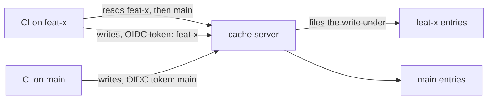

Starting with vx is now one command: `vx init` installs vx for you.
A cache server, not the client, now keeps a branch's builds out of
main's entries. A remote hit whose download would outlast the task
gives way and the task runs here, and a local hit copies its files out
without checking them first.

This release is breaking: `cache.store.verify` is gone, task keys reach
the remote plain, and `vx init` maps only Turbo and Nx repos.
Read the [breaking changes](#breaking-changes) first.

Enjoy the release!

**In this release**

- [One command to start](#one-command-to-start)
- [Branch caches the cache server enforces](#branch-caches-the-cache-server-enforces)
- [A slow download no longer holds a fast task](#a-slow-download-no-longer-holds-a-fast-task)
- [Other noteworthy changes](#other-noteworthy-changes)
- [Breaking changes](#breaking-changes)

## One command to start

Starting meant installing `@vzn/vx` first, then running `vx init`.

Now `vx init` installs vx itself: globally, with the package manager
that started it, so a bare `vx` is on your PATH (skipped when that `vx`
is already this version), and as a root devDependency with the repo's
own manager. Beside a `turbo.json` or `nx.json` it hands the repo to
`@vzn/vx-migrate`; anywhere else it writes `.vx/workspace.ts` and an
empty root `vx.config.ts`, then locks.

```sh frame="terminal"
bunx @vzn/vx init
```

```txt frame="terminal"
─ vx init 0.0.645 ────────────────────────────────────────────
  from       no turbo.json or nx.json: one project, the root
  files      .vx/workspace.ts
             vx.config.ts
             .vx/.gitignore
             .vx/.gitattributes
  installed  bun add -g @vzn/vx@0.0.645
             bun add @vzn/vx@0.0.645 --dev
  lock       1 project config → .vx/projects.lock.json
  next       declare a task in vx.config.ts, then vx lock && vx run <task>
```

See the [quickstart](../../quickstart/).

## Branch caches the cache server enforces

A pull request should read what main built and never write where main
reads. vx used to decide that on the client, with a second, scoped key
per task, so only the client kept a branch out of main's entries.

Task keys now reach every remote plain. The CI OIDC token, checked
against the cache server's trust policy, decides where a write lands:
main's entries, the token's own branch, or nowhere. `turboCache()` only
steers reads: every `HEAD`, `GET` and batch `POST` names the run's refs,
its own branch first, in `x-artifact-read-scopes`. On CI the refs come
from its env; on a laptop from git (the current branch, then
`origin/HEAD`).

```txt frame="terminal"
HEAD /v8/artifacts/0a1b2c3d4e5f6789
x-artifact-read-scopes: refs/heads/feat-x, refs/heads/main
```



For a server that ignores the header, such as Vercel's,
`turboCache({ scope: 'key' })` folds the ref into each key and asks for
every ref's key in one batch; the first hit wins. How a server
implements its half:
[Branch caches a server enforces](../../blog/branch-caches-a-server-enforces/).

## A slow download no longer holds a fast task

A remote hit always waited for its whole body, even when running the
task would have finished first: a large artifact on a slow link held its
task longer than the task takes.

A remote that says an entry's size and the task's stored time (Turbo's
API does, in its batch query and `HEAD`) now lets vx weigh each download
while a task waits on it. When the rest of the body would take longer
than twice the task's stored time, room for the run and its save, vx
gives the download up and runs the task here. It uploads nothing: the
remote already holds the key. A remote that says neither is awaited, as
before. With 500 tasks 30 ms away at 4 MB/s, 20 of them 8 MB, a run went
from 3,070 ms to 1,807 ms (min of 5 runs, before and after the
change).

The run's footer now says how many bytes each remote direction moved,
and `--dry` says what restoring the remote hits would download:

```txt frame="terminal"
4 task(s) planned, 2 cache hits (1 local, 1 remote, 12 MB), 1 would run, 1 no-cache.
```

## Other noteworthy changes

- A local hit copies its stored files out without checking their size,
  mtime or bytes first, and a save no longer reads its outputs back to
  write a checksum. The local store is vx's own, so the check caught
  nothing. A remote hit is still checked against its archive's checksum
  when it is unpacked.

## Breaking changes

- `cache.store.verify` and `VX_CACHE_STORE_VERIFY` are removed: delete
  them from `.vx/workspace.ts` and the environment.
- Scoped task keys are removed: task keys are plain on every remote.
- The `x-vx-cache-scope` header (`turboCache()`, `nxCache()`) is
  removed; `turboCache()` sends `x-artifact-read-scopes` on reads.
- `VX_CACHE_SCOPE`, `github({ cacheScope })` and `gitlab({ cacheScope })`
  now scope only plugin entries (`ctx.cache`, run records).
- `vx init` in a repo with only a `package.json` writes one empty root
  project and no longer maps scripts: run `bunx @vzn/vx-migrate` for
  that.
- Plugin API: `RemoteCacheLayer` methods take no `RemoteKey`, and
  `RemoteKey` is removed. `has` resolves `ArtifactInfo` or `null`, not a
  boolean; `hasMany` resolves a `Map` of the held keys to `ArtifactInfo`,
  not a `Set`.

See also [Upgrading](../../guides/upgrading/).

## How to update

```sh frame="terminal"
vx upgrade
```
