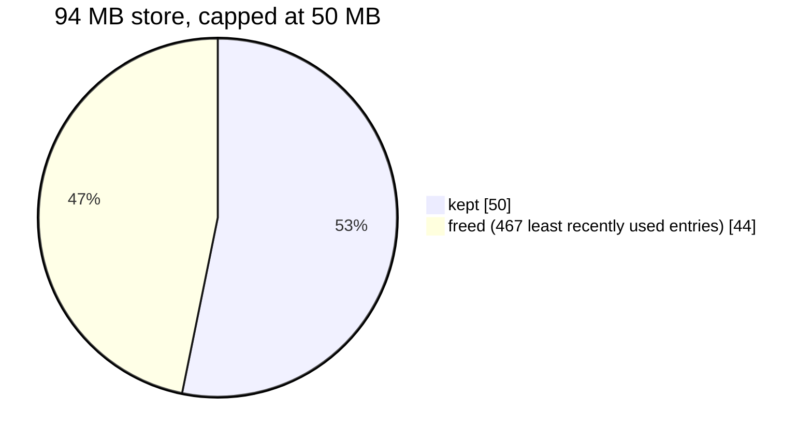

`vx cache clean` keeps the cache at the size you pick, by age and by
last use. A store of 1,000 entries, 94 MB, capped at 50 MB:

```sh frame="terminal"
$ vx cache clean --max-size 50M --dry-run
› vx cache clean  would free 44 MB (dry run)

  467 entries

$ vx cache clean --max-size 50M
✓ vx cache clean  freed 44 MB

  467 entries
```



<small>Demo workspace, 1,000 projects · vx 22f6eb7 · 2026-10-23</small>

The dry run lists what would go. The real clean removes exactly that.

## Two policies: age, then size

| Flag            | Evicts                                                     |
| --------------- | ---------------------------------------------------------- |
| `--older-than`  | entries nobody used for that long; a hit counts as a use   |
| `--max-size`    | least recently used entries, until the store fits          |

Use one or both. Age goes first. Durations: `30d`, `24h`. Sizes:
`500M`, `1gb`, `32KiB` (powers of 1024).

Set the cap above what one full build saves, or you evict that build.
`vx info` shows the current size:

```sh frame="terminal"
$ vx info
  cache entries     1000 (94 MB)
```

## Run it on a schedule

No run deletes anything. Put the clean in cron or a scheduled CI job:

```sh frame="terminal"
vx cache clean --older-than 30d --max-size 10G
```

## A bound of zero is refused

```sh frame="terminal"
$ vx cache clean --max-size 0
✗ vx cache clean  --max-size 0 would evict every entry — `vx cache clean` with no bound clears the whole cache

$ vx cache clean --max-size 10
✗ vx cache clean  --max-size 10 would read as 10 bytes and evict nearly everything — give a unit (e.g. 10M, 10G)
```

A zero or a bare number is usually a mistake. To clear everything, run
`vx cache clean` with no bound. `--global` clears every repo's store.

## Files no index knows

The cache is a SQLite index plus entry files. They can drift apart, for
example after a crashed save. Every clean sweeps these orphans.

Nothing younger than an hour is taken, and only file names vx writes.
Your own `release.tar.zst` in a shared folder is never touched.

## For scripts and agents

```sh frame="terminal"
$ vx cache clean --max-size 50M --dry-run --format json
{"dryRun":true,"evicted":467,"bytesFreed":45907968,"orphans":0,"orphanBytes":0}
```

A clean waits for a running `vx run` on the same workspace. If another
workspace shares the cache, a deleted entry becomes a miss and the
task runs.

Reference: [`vx cache clean`](../../cli/cache/) and the
[schema](../../schema/). More at
[vznjs.github.io/vx](https://vznjs.github.io/vx/).
