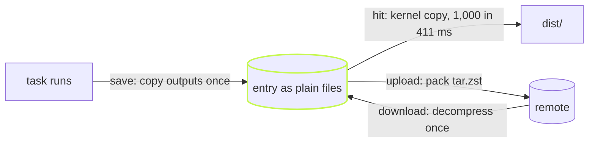

A local cache hit is a file copy the kernel does. 1,000 hits of 96 KiB
restore in 411 ms. With `dist` deleted:

```sh frame="terminal"
$ rm -rf packages/*/dist && time vx run build --all
  cache     local 1000↓
  time      214ms
real    0m0.411s

$ rm -rf packages/*/dist && time VX_CACHE_STORE_DECOMPRESS=false vx run build --all
  cache     local 1000↓
  time      618ms
real    0m0.686s
```

Same entries, two ways to keep them on disk:

| Store (`cache.store.decompress`) | Restore all 1,000 | Store on disk |
| -------------------------------- | ----------------- | ------------- |
| plain files (`true`, default)    | 411 ms            | 111 MB        |
| one `tar.zst` each (`false`)     | 686 ms            | 99 MB         |

<small>Min of 5 restores, 3 interleaved arms, fresh store per arm · `private/vx-bench/generate.ts`, 1,000 projects, 96 KiB random output each · Linux x64, 4 cores · vx a1786b3 · 2026-10-23</small>



## The kernel does the copy

Archives exist only on the network. Locally, each entry is stored as
plain files, unpacked once.

A hit hands each file to the kernel: `copy_file_range` on Linux, or a
clone on APFS, Btrfs or XFS. A clone shares blocks until one side
writes, so a big output restores without copying bytes.

vx never hard-links. A hard link would be faster, but then editing
`dist/index.js` in place would edit the cache too, and the next hit
would restore your edit. A copy or clone keeps the cache safe.

## Small entries stay in the index

A thousand tiny outputs as a thousand folders is more work than the
bytes are worth. So an entry up to 32 KiB stays in the SQLite index as
one compressed row. You can change the limit:

```ts
// .vx/workspace.ts
import { defineWorkspace } from '@vzn/vx/config'

export default defineWorkspace({
  cache: { store: { embeddings: '64KiB' } }, // false keeps every entry as files
})
```

If disk matters more than speed, `decompress: false` keeps each entry
as one `tar.zst`, as in the table.

## A local hit checks nothing

Only vx writes to its local store, so checking each file on a hit would
guard against nothing and slow every save.

Anything from the network is checked: a remote entry ends with a CRC-32,
and a wrong sum is a miss.

## A download is decompressed once

Up to 4 MiB is fetched whole, decompressed once and written into the
store, then checked. Larger ones go through a temp file, still
decompressed once.

Storage layout and settings: [Caching](../../caching/) and the
[schema](../../schema/). More at
[vznjs.github.io/vx](https://vznjs.github.io/vx/).
