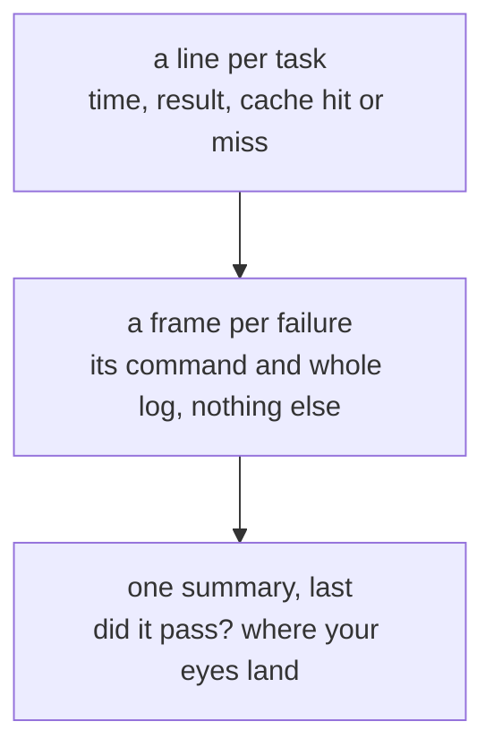

You see one line per task, the full log only for what failed, and one
summary at the bottom. Here 8 tasks run in parallel and one test fails:

```sh frame="terminal"
$ vx run build test --filter packages/a --filter packages/b --filter packages/c --filter packages/d --force
 ⏺︎    13ms success miss     packages/d#build
 ⏺︎    15ms success miss     packages/a#test
 ⏺︎    18ms success miss     packages/a#build
 ⏺︎    19ms success miss     packages/b#build
 ⏺︎    13ms success miss     packages/c#test
 ⏺︎    12ms success miss     packages/d#test
 ◼︎    10ms failed  miss     packages/b#test
 ⏺︎     7ms success miss     packages/c#build

┌─ packages/b#test > failed (exit 1)

$ bun test

├─ OUTPUT ────────────────────────────────────────────────────

src/sum.test.ts:
2 | test('adds', () => { expect(2 + 2).toBe(5) })
                                       ^
error: expect(received).toBe(expected)

Expected: 5
Received: 4
…
└─ packages/b#test ── (10ms) failed (exit 1)

─ vx 0.0.0 ───────────────────────────────────────────────────
  projects  ▰▰▰▰▰▰▰▰▰▰▰▰▰▰▰▰▰▰▰▰▰▰▰▰▰▰▰▰▰▰▰▰▰▱▱▱▱▱▱▱▱▱▱▱▱▱▱▱▱▱
            4 affected · 6 total
  tasks     ▰▰▰▰▰▰▰▰▰▰▰▰▰▰▰▰▰▰▰▰▰▰▰▰▰▰▰▰▰▰▰▰▰▰▰▰▰▰▰▰▰▰▰▰▰▰▰▰▰▰
            1 failed · 7 success · 8 total
  cache     ▰▰▰▰▰▰▰▰▰▰▰▰▰▰▰▰▰▰▰▰▰▰▰▰▰▰▰▰▰▰▰▰▰▰▰▰▰▰▰▰▰▰▰▰▰▰▰▰▰▰
            local 7↑ · 1 miss

  info      4 workers · local cache · run 01a16aea-85b2-75d4-bb1c-d5c8ae6dd898
  time      59ms · max 19ms · avg 13ms · min 7ms
```

<small>Demo workspace · vx 69617eb · 2026-10-23</small>

## Three parts, read top to bottom



`--output-logs full` gives every task its own frame, in the order they
finish. On CI the frames fold into log groups. `vx last` prints the
summary again later.

Fix the test and run again. Four tasks come from the cache, and the run
takes 30 ms.

More at [vznjs.github.io/vx](https://vznjs.github.io/vx/).
