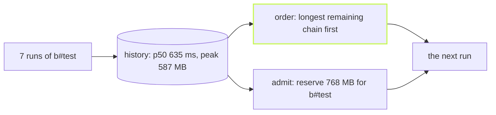

A few runs of the demo workspace, then:

```sh frame="terminal"
$ vx history
history: last 20 runs · budgets 4 cores (the default worker count; --concurrency changes it per run) · 13677 MB (what this process may use)
  task              runs      p50  peak rss    cpu  reserves
  packages/a#build    15     15ms         —   1.1×  —
  packages/a#test      8     12ms         —   0.8×  —
  packages/b#build    12     19ms         —   0.9×  —
  packages/b#test      7    635ms    587 MB   0.5×  768 MB
  packages/c#build    10      7ms         —   1.2×  —
  packages/c#test      7     21ms         —   0.7×  —
  packages/d#build    12     13ms         —   0.8×  —
  packages/d#test      7     10ms         —   0.9×  —
  16 tasks with no execution in the window reserve nothing
```

`b#test` allocates 600 MB, so it reserves 768 MB: its peak plus a
quarter, rounded up to 64 MB. The light tasks reserve nothing and run
freely. Demo workspace, vx at `22f6eb7`, 2026-10-23.

That table is `@vzn/vx-schedule-history` at work. The core scheduler
orders tasks by the shape of the graph: a task that many others wait on
goes first. That is a good guess with no data. After a few runs there
is data, and the plugin uses it.



## Turn it on

```ts
// .vx/workspace.ts
import { defineWorkspace } from '@vzn/vx/config'
import { scheduleHistoryPlugin } from '@vzn/vx-schedule-history'

export default defineWorkspace({ plugins: [scheduleHistoryPlugin()] })
```

It reads the last 20 runs from the cache's own database, once per run.
A broken read warns and falls back to the core order, so the plugin can
never fail a build.

## The longest chain first

Each ready task is weighted by its own median time plus the longest chain
of tasks still waiting behind it. A slow docs build that sits at the end
of the graph starts early, instead of last on an otherwise idle machine.
A fresh CI runner has no history yet, so `assume` names durations for the
tasks you know are slow:

```ts
scheduleHistoryPlugin({ assume: { '@demo/docs#build': 30_000 } })
```

A recorded median always wins over an assumption.

## Packed by real memory

Every execution records its CPU time and peak memory. The plugin starts
a task only while every reservation running beside it fits in the
machine's memory, capped by the container's limit. Two memory-hungry
test suites stop starting at the same moment and crashing a small
runner.

A cache hit carries the usage of the run that produced it, so a runner
that restored a task from a remote cache knows its reservation without
ever executing it. `--format json` gives the table for scripts, and
`reservations` declares a size by hand for what history cannot know yet.

It orders and admits. It never changes what runs or how a task is keyed.
Every option is in the
[vx-schedule-history README](https://github.com/vznjs/vx/tree/main/packages/vx-schedule-history#readme).
More at [vznjs.github.io/vx](https://vznjs.github.io/vx/).
