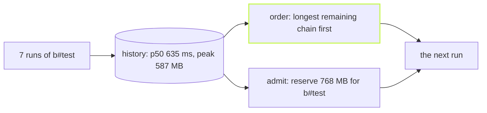

`@vzn/vx-history` learns from your past runs. It starts the
longest chain first, and keeps memory-hungry tasks from starting
together. After a few runs:

```sh frame="terminal"
$ vx history
history: last 20 runs · budgets 4 cores (the default worker count; --concurrency changes it per run) · 13677 MB (what this process may use)
  task              runs      p50  peak rss    cpu  reserves
  packages/a#build    15     15ms         —   1.1×  —
  packages/a#test      8     12ms         —   0.8×  —
  packages/b#build    12     19ms         —   0.9×  —
  packages/b#test      7    635ms    587 MB   0.5×  768 MB
  packages/c#build    10      7ms         —   1.2×  —
  packages/c#test      7     21ms         —   0.7×  —
  packages/d#build    12     13ms         —   0.8×  —
  packages/d#test      7     10ms         —   0.9×  —
  16 tasks with no execution in the window reserve nothing
```

`b#test` peaks at 587 MB, so it reserves 768 MB: its peak plus a
quarter, rounded up to 64 MB. Light tasks reserve nothing.

<small>Demo workspace · vx 22f6eb7 · 2026-10-23</small>

Without the plugin, vx orders tasks by the shape of the graph: a task
many others wait on goes first. That's a good guess with no data. With
history, the plugin uses real times.



## Turn it on

```ts
// .vx/workspace.ts
import { defineWorkspace } from '@vzn/vx/config'
import { vxHistory } from '@vzn/vx-history'

export default defineWorkspace({ plugins: [vxHistory()] })
```

It reads the last 20 runs from the cache database, once per run. If the
read breaks, it warns and uses the core order. It can't fail a build.

## The longest chain first

Each ready task's weight is its median time plus the longest chain
waiting behind it. A slow docs build at the end of the graph starts
early, not last on an idle machine.

A fresh CI runner has no history, so `assume` names tasks you know are
slow:

```ts
vxHistory({ assume: { '@demo/docs#build': 30_000 } })
```

A recorded median always beats an assumption. To carry history between
CI runners, see [the timings file](../ci-timings-file/).

## Packed by real memory

Every run records each task's CPU time and peak memory. A task starts
only while all reservations fit in the machine's memory, or the
container's limit.

Two heavy test suites do not start together and crash a small runner.

A cache hit carries the numbers of the run that made it, so a runner
knows a task's size without running it. `reservations` sets a size by
hand for tasks with no history yet.

The plugin only orders and admits. It never changes what runs or a
task's key. Every option is in the [vx-history
README](https://github.com/vznjs/vx/tree/main/packages/vx-history#readme).

More at [vznjs.github.io/vx](https://vznjs.github.io/vx/).
