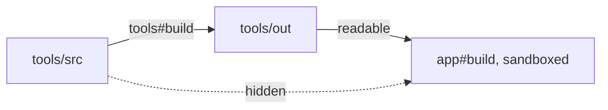

One project builds a tool, every other project runs it, and each stays
in its sandbox. The tool's sources stay hidden.



## Depend on a task, read its outputs

```ts
build: {
  dependsOn: ['packages/tools#build'],
  exec: {
    command: 'cat ../tools/out/bin/greet ../tools/src/greet.sh > greeting.txt',
    sandbox: { allow: { read: ['.'], write: ['greeting.txt'] } },
  },
  inputs: { files: ['src/**'] },
  outputs: { files: ['greeting.txt'] },
  cache: true,
}
```

The output reads fine. The source does not exist for this task:

```ansi
┌─ packages/app#build > failed (exit 1)

$ cat ../tools/out/bin/greet ../tools/src/greet.sh > greeting.txt

├─ OUTPUT ────────────────────────────────────────────────────

cat: ../tools/src/greet.sh: No such file or directory

├─ SANDBOX ───────────────────────────────────────────────────

vx: the sandbox hid paths outside the project that exist on this machine, which are not reported as violations: /work/demo/packages/tools/src/greet.sh. If the task reads one, grant it, e.g. `allow: { read: ['../tools/src/greet.sh'] }`.

└─ packages/app#build ── (59ms) failed (exit 1)
```

<small>Demo workspace · Linux, bubblewrap · vx 18d0a91 · 2026-11-07</small>

The outputs are safe to read. The task's key already moves with every
file that made them, so a cache hit never hides a changed tool.

## hermetic: true closes off the machine too

A plain sandbox walls off the workspace. `hermetic: true` moves that
wall to `/`. The task reads only what you grant, plus the shell vx needs.

```ansi
┌─ packages/app#build > failed (exit 127)

$ cat ../tools/src/greet.sh > greeting.txt

├─ OUTPUT ────────────────────────────────────────────────────

/usr/bin/sh: 1: cat: not found
[vx] exit 127 is the shell's "command not found": cat is /usr/bin/cat on the host, but no sandbox grant reads it, so inside the sandbox it is not there — add it (or its directory) to exec.sandbox.allow.read

└─ packages/app#build ── (124ms) failed (exit 127)
```

The task reached for the host's `cat` and found nothing. vx names the
host path and the grant that would fix it. A build cannot lean on a tool
that only your laptop has.

| Sandbox           | Workspace      | Rest of the machine |
| ----------------- | -------------- | ------------------- |
| none              | everything     | everything          |
| `sandbox: {...}`  | what you grant | readable            |
| `hermetic: true`  | what you grant | what you grant      |

How to grant reads: [Sandboxing](../../docs/sandboxing/).
More at [vznjs.github.io/vx](https://vznjs.github.io/vx/).
