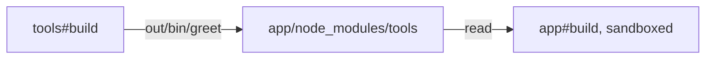

One project builds a tool, another runs it. The app reads the tool the
way its code would: from `node_modules`, where the package manager linked it.



## Depend on the project you read

`app` lists `tools` in its `package.json`. Its `build` depends on
`^build`, so its key holds the key of `tools#build`:

```ts
build: {
  dependsOn: ['^build'],
  exec: {
    command: 'sh node_modules/tools/out/bin/greet > greeting.txt',
    sandbox: { allow: { read: ['.'], write: ['greeting.txt'] } },
  },
  inputs: { files: ['src/**'] },
  outputs: { files: ['greeting.txt'] },
  cache: true,
}
```

Edit `tools/src/greet.sh` and build the app. Both tasks run again:

```ansi
  Tasks     status  cache     ±usual    time   cpu    mem outputs  blocks worker         task                           
            success miss       −17ms    59ms     —      —     19B       1 local          tools#build
            success miss       −19ms    42ms     —      —     14B       0 local          app#build
```

The path never names where `tools` lives. Move it, and only the link moves.

## Drop the edge, and the read is refused

Without `dependsOn`, an edit to `tools` would not move the app's key, and
a cache hit would replay a stale greeting. So the sandbox hides it:

```ansi
┌─ app#build > failed (exit 2, 1 sandbox violation)

packages/app $ sh node_modules/tools/out/bin/greet > greeting.txt

├─ OUTPUT ────────────────────────────────────────────────────

sh: 0: cannot open node_modules/tools/out/bin/greet: No such file

├─ SANDBOX VIOLATIONS (1) ────────────────────────────────────

openat(node_modules/tools/out/bin/greet) = -1 ENOENT  [/tmp/claude-0/tmp/demo/packages/tools/out/bin/greet]
vx: app#build read `packages/tools` (linked at `packages/app/node_modules/tools`), and its key includes no task of tools, so an edit there would not re-run it. Add a `dependsOn` edge that reaches one (`^build`, or `tools#build` where it keys its sources), or grant and key the files yourself (`allow.read` plus `inputs.workspaceFiles`).
```

vx names the link the task read through and the edge that makes the read
safe. Add `^build` back and the run passes.

How to grant reads: [Sandboxing](../../docs/sandboxing/).
More at [vznjs.github.io/vx](https://vznjs.github.io/vx/).
