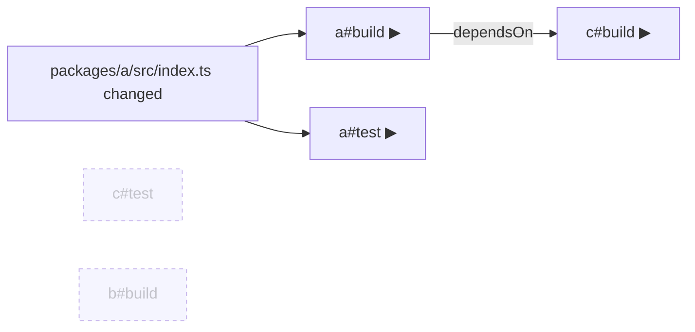

`--affected` runs only what your branch changed and what depends on it.
Each task says why it was picked.

```sh frame="terminal"
$ vx run build test --affected=master --dry
would run:
  ▶  packages/a#build  cache miss — would exec   6802a43d  ~10ms
                       affected: packages/a/src/index.ts changed (an input)
  ▶  packages/c#build  cache miss — would exec   24d525d5  ~8ms
                       affected: packages/a/src/index.ts changed (an input), via packages/a#build
  ▶  packages/a#test   cache miss — would exec   d0093233  ~11ms
                       affected: packages/a/src/index.ts changed (an input)

3 task(s) planned, 3 would run.

$ vx run build test --affected=master
 ⏺︎     8ms success miss     packages/a#test
 ⏺︎    17ms success miss     packages/a#build
 ⏺︎     8ms success miss     packages/c#build
  projects  2 affected · 5 total
  tasks     3 success · 3 total
```

3 of 8 tasks ran. `c#test` doesn't read `a`, so it stayed out.

<small>Demo workspace · vx 69617eb · 2026-10-23</small>

## It follows task edges



`c` has no package dependency on `a`. Its `build` is still downstream,
through `dependsOn`. The set is what your tasks really depend on, not
only `package.json`.

## Which base it compares to

Name one with `--affected=main`, or let vx pick. On a pull request,
`github()` gives the PR's base commit.

Elsewhere vx uses the merge base with your base branch (`origin/HEAD`,
else `main` or `master`, or `baseBranch` in `.vx/workspace.ts`).

On the base branch itself, run `--all`: the cache skips what did not
change.

CI needs no history for this. On `main` the current commit is enough.
On a branch, vx fetches the base commit and the commits down to where
the branch started, without file contents.

It is short for `--filter "...[<base>]"`, so it combines with other
filters. `vx show --affected` lists the projects without running.

## The cache still decides what runs

`--affected` picks the projects. The cache key picks the tasks that run.
Edit a README and its project joins the set, but every task there is a
cache hit.

Reference: [the CLI](../../cli/run/#--affectedbase). More at
[vznjs.github.io/vx](https://vznjs.github.io/vx/).
