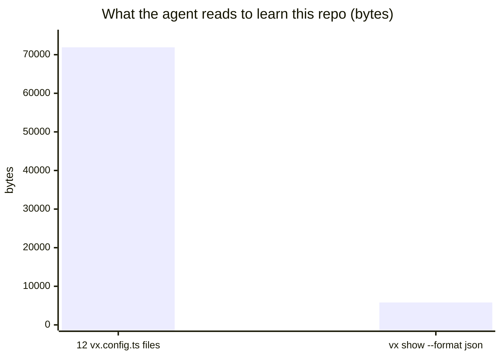

Your coding agent asks the same questions you do: what can I run, why
did that re-run, which tasks flake. vx answers each as JSON. Why did a
task re-run?

```sh frame="terminal"
$ vx why packages/a#build --format json | jq -c '.diff.entries[0]'
{"kind":"file","name":"packages/a/src/index.ts","change":"changed","before":"d64be65d2e8131eabf0e284282b457be62aebe14","after":"e9de63a046c5c557ab363dd935aa4cf14a3db016"}
```

No reading configs, no re-running to find out.



<small>This repo: 13 projects, 201 tasks · `vx show` in 106 ms, min of 7 · Linux x64 · vx 69617eb · 2026-10-23</small>

Install the skill that tells the agent which command to use:

```sh frame="terminal"
$ bunx skills add vznjs/vx
```

To match the vx version installed, copy it from the package:

```sh frame="terminal"
$ mkdir -p .claude/skills/vx
$ cp node_modules/@vzn/vx/skills/vx/SKILL.md .claude/skills/vx/
```

## What it answers

| The question                                          | The command                                     |
| ----------------------------------------------------- | ----------------------------------------------- |
| What can I run here?                                  | `vx show --format json`                         |
| What does this task declare?                          | `vx show app#build --format json`               |
| What would run, and why?                              | `vx run test --affected=origin/main --dry=json` |
| What did the last run do?                             | `vx last --format json`                         |
| Why did the last run fail?                            | `vx last --failed --format json`                |
| What did this task print?                             | `vx last --log app#build`                       |
| Why did `app#build` re-execute instead of hitting?    | `vx why app#build --format json`                |
| How fast is each task, and which ones flake?          | `vx last --stats --format json`                 |
| What is this workspace, and what is in its cache?     | `vx info --format json`                         |
| Is the config lock current?                           | `vx lock --check --format json`                 |
| What would adopting vx write here?                    | `vx init --dry --format json`                   |
| Where is this documented?                             | `vx docs <words> --format json`                 |

- **stdout always parses.** One JSON document. Notices go to stderr.
  Each shape has a schema in `node_modules/@vzn/vx/schemas/`.
- **Flaky means flaky.** Only a retry pass, or one key that both failed
  and passed ([flaky](../flaky-tasks/)).
- **A refusal is data:** one line with a stable code and a link to the
  fix ([refusals](../error-codes/)).

## Why the CLI and not a server

Nothing extra to install, no process to keep alive, no port. The agent
already runs shell commands, and gets the same answers, refusals and
sandbox a person does.

## Letting it run the build too

Reading is half.

To let an agent *run* builds safely, vx has:

- explicit inputs;
- [strict outputs](../strict-output-ownership/);
- a [sandbox](../the-sandbox/) that blocks undeclared reads and domains;
- a [teardown](../ctrl-c/) that leaves nothing running.

An agent that can only run declared commands on declared paths is one
you can leave alone with the repo.

Guide: [AI agents](../../docs/agents/). More at
[vznjs.github.io/vx](https://vznjs.github.io/vx/).
