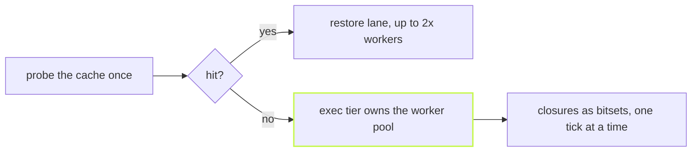

vx ranks 3,270 tasks in single-digit milliseconds. Done with set unions,
the same work took 8.5 seconds, on every run, since no daemon keeps it.

## Each closure is one row of bits

vx needs to know how much work sits below each task. Each task gets a
row of bits, one per task, all in one `Uint32Array` (1.3 MB at 3,270
tasks). A union is a bitwise OR and a count is a popcount.

`--filter '...app'` and `--affected` use the same rows. A filter seeded
by one or two packages (`app...`) searches from them instead, since that
is cheaper.

## A finished task touches only its neighbours

Ready tasks sit in a binary max-heap, most work below first. When a task
finishes, vx counts down its direct dependents and pushes the ones that
hit zero. Nothing rescans the graph.

`@vzn/vx-history` swaps the count for durations learned from past runs.

## Restores never take a build's slot

vx checks the local cache for every stable task before the run. Misses
own the workers. Hits go to their own lane, capped at twice the worker
count, since a restore is disk work.

`--concurrency 1` stays serial. A task whose key must wait for an
upstream joins neither tier.

## Memory limits come from a plugin

Core limits only the worker count. The `admit` stage can hold a ready
task. `@vzn/vx-history` learns each task's peak memory and
packs tasks against the machine's RAM.

Reference: [Architecture](../../architecture/). More at
[vznjs.github.io/vx](https://vznjs.github.io/vx/).
