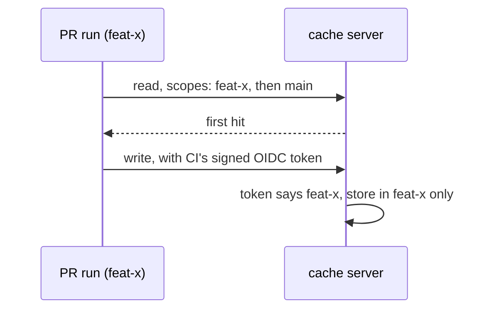

A pull request reuses everything `main` built. Nothing it builds can
land in `main`'s cache, so one bad build cannot poison the next run.



| Decision                    | Who makes it | From what                                   |
| --------------------------- | ------------ | ------------------------------------------- |
| Where a write lands         | the server   | the CI's signed OIDC token                  |
| Which branches a read sees  | the client   | one header, own branch first, then `main`   |

## The token decides writes

The server checks the CI's signed OIDC token against its trust policy. A
matching token writes the trusted cache. Any other token from the repo
writes only its own branch. No token writes nothing.

No header or key can change that.

## One header steers reads

```http
HEAD /v8/artifacts/0a1b2c3d4e5f6789
x-artifact-read-scopes: refs/heads/feat-x, refs/heads/main
```

The server returns the first hit in that order. Keys are the same on
every branch, so a hit on `main` is the bytes `feat-x` would have built.
A server that ignores the header keeps one shared cache.

CI refs come from env (`GITHUB_HEAD_REF` or `GITHUB_REF`, then
`GITHUB_BASE_REF`; `CI_COMMIT_REF_NAME`, then
`CI_MERGE_REQUEST_TARGET_BRANCH_NAME`).

On a laptop they come from git: the current branch, then `origin/HEAD`.

## Two client modes

| `scope` | Key | Read request | For |
| --- | --- | --- | --- |
| `'header'` (default) | `hash(inputs)` | plain key + `x-artifact-read-scopes` | servers that implement the rules below |
| `'key'` | `hash(inputs + ref)` | one batch with each ref's key, first hit wins | servers that ignore the header (Vercel) |

```ts
// .vx/workspace.ts
import { defineWorkspace } from '@vzn/vx/config'
import { turboCache } from '@vzn/vx-migrate'

export default defineWorkspace({
  plugins: [turboCache({ scope: 'key' })], // a server that ignores the header
})
```

```ts
// .vx/workspace.ts
import { defineWorkspace } from '@vzn/vx/config'
import { turboCache } from '@vzn/vx-migrate'

export default defineWorkspace({
  plugins: [turboCache({ scope: 'key' })], // a server that ignores the header
})
```

`'key'` separates branches but secures nothing: anyone can compute
`main`'s key. Only a server can enforce, so `'header'` is the default.

`nxCache()` sends plain requests, since the Nx spec has no batch query.

## Building the server half

Everything below is the Turbo artifacts API (`/v8/artifacts`) plus one
header.

### Server config

vx's own [cache server](../../docs/servers/cache/) does this over its
`/v1` wire. For a server on the Turbo wire, here is an example: a trust
policy per team.

A rule names token claims; each value is an exact string, a glob, or a
list.

A token matches a rule when every claim in it matches.

```ts
export default {
  trust: [
    // GitHub: main and merge queue, only from the main-branch workflow
    {
      iss: 'https://token.actions.githubusercontent.com',
      repository_id: '123456789',
      event_name: ['push', 'merge_group'], // pull_request_target and issue_comment run PR code with ref=main
      ref: ['refs/heads/main', 'refs/heads/gh-readonly-queue/main/*'],
      ref_protected: 'true', // an unprotected branch can be pushed with unreviewed code
      job_workflow_ref: 'org/repo/.github/workflows/ci.yml@refs/heads/main',
    },
    // GitLab: protected main, on our own runners
    {
      iss: 'https://gitlab.com',
      project_id: '4567',
      ref_path: 'refs/heads/main',
      ref_protected: 'true',
      pipeline_source: ['push', 'schedule'], // a manual pipeline can inject CI variables
      runner_environment: 'self-hosted',
    },
  ],
}
```

Pin `repository_id` or `project_id`, not the name: after a rename or
delete, another repository can take the name, never the id.

Trusted is `main` and its merge queue only: anyone who can push can tag
any commit, so a tag's run writes to its own scope, as a branch does.

### Write scope

Built into the server, not configurable. A token that matches no rule
writes to:

- **GitHub:** `refs/heads/<head_ref>` on a PR run, otherwise `ref`. A PR
  run writes to its head branch, so a laptop finds it from git alone.
- **GitLab:** `ref_path`.

### Rules

1. **Auth.** Accept GitHub and GitLab OIDC tokens as `Authorization:
   Bearer`, and verify the signature (the issuer's JWKS), `iss`, `aud`
   and `exp`.

   Every read needs a token. Each developer creates their own read-only
   token, and a shared read-only token may serve other CIs; neither ever
   writes.
2. **Audience.** `aud` must be this server's own, so a token minted for
   another service can't be replayed here.
3. **Trust match.** As above: every claim a rule names must match.
4. **Write** (`PUT /v8/artifacts/:hash`). A token that matches a rule
   stores to trusted. Any other token stores to its write scope. A token
   from a repository or project no rule names writes nothing. Entries
   are immutable.
5. **Read** (`GET` and `HEAD /v8/artifacts/:hash`, and the batch
   `POST /v8/artifacts`). For each ref in the header, in order: if it
   matches a rule's ref glob, look in trusted; otherwise look in that
   ref's scope. Return the first hit.
6. **No header.** Read from trusted only, so plain Turbo clients keep
   working.
7. **Per repository.** Every scope, trusted included, lives in that
   repository's own bucket, taken from the token (`repository_id`,
   `project_id`, or the read token's repository). One team's repositories
   never share a branch.
8. **Header limits.** Each entry must be a `refs/...` string; dedupe the
   list and cap it at 8 refs. vx sends at most 8.
9. **Merge queue.** It writes to trusted before its code lands, so a
   queued PR that drops out leaves trusted entries behind. That is
   accepted: queue code is approved code.

### GitHub

| Run | Token holds | `x-artifact-read-scopes` | Server reads (first hit) | Server writes |
| --- | --- | --- | --- | --- |
| main push | `ref=refs/heads/main` | `refs/heads/main` | trusted | trusted |
| merge queue | `ref=refs/heads/gh-readonly-queue/main/…` | `refs/heads/gh-readonly-queue/main/…, refs/heads/main` | trusted | trusted |
| PR #12 (feature→main) | `ref=refs/pull/12/merge`, `head_ref=feature`, `base_ref=main` | `refs/heads/feature, refs/heads/main` | feature, trusted | `refs/heads/feature` |
| branch push | `ref=refs/heads/feature` | `refs/heads/feature, refs/heads/main` | feature, trusted | `refs/heads/feature` |
| fork PR | no token | `refs/heads/<head>, refs/heads/main` | nothing (no token) | nothing |
| local on main | personal token (read-only) | `refs/heads/main` | trusted | nothing |
| local on feature | personal token (read-only) | `refs/heads/feature, refs/heads/main` | feature, trusted | nothing |

### GitLab

| Run | Token holds | `x-artifact-read-scopes` | Server reads (first hit) | Server writes |
| --- | --- | --- | --- | --- |
| main pipeline | `ref_path=refs/heads/main` | `refs/heads/main` | trusted | trusted |
| merge train | `ref_path=refs/heads/feature` | `refs/heads/feature, refs/heads/main` | feature, trusted | nothing (client read-only) |
| MR or merged results (feature→main) | `ref_path=refs/heads/feature` | `refs/heads/feature, refs/heads/main` | feature, trusted | `refs/heads/feature` |
| branch pipeline | `ref_path=refs/heads/feature` | `refs/heads/feature, refs/heads/main` | feature, trusted | `refs/heads/feature` |
| fork MR | fork project's token | `refs/heads/feature, refs/heads/main` | nothing (wrong project) | nothing (wrong project) |
| local on main | personal token (read-only) | `refs/heads/main` | trusted | nothing |
| local on feature | personal token (read-only) | `refs/heads/feature, refs/heads/main` | feature, trusted | nothing |

A GitLab token has no merge-train claim, so the server would store a
train's results in the source branch's scope.

Those results are built from the branch merged with main and the MRs
ahead of it, so the branch almost never reuses them. The CI knows it is
a train, so turn writes off there:

```yaml
build:
  rules:
    - if: $CI_MERGE_REQUEST_EVENT_TYPE == "merge_train"
      variables:
        VX_CACHE_POLICY: local:rw,remote:r
    - when: on_success
```

A stacked PR (feature-b→feature) reads `feature-b, feature, main` in CI
and `feature-b, main` on a laptop.

## What the client sends

- Task keys reach every remote plain.
- `turboCache()` sends `x-artifact-read-scopes` on every read; a `PUT`
  names no scope.
- `VX_CACHE_SCOPE`, `github({ cacheScope })` and `gitlab({ cacheScope })`
  scope only what plugins store themselves (`ctx.cache`, run records).

The remote cache page's [cache scopes and tokens](../../docs/remote-cache/#cache-scopes-and-tokens) has the setup.
More at [vznjs.github.io/vx](https://vznjs.github.io/vx/).
