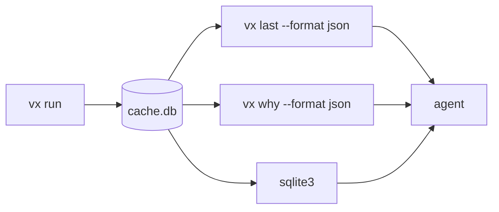

A coding agent can't read a progress bar. It parses stdout. So every
vx answer comes as JSON with a schema, a failure keeps its log and the
files it blames, and the run history is a SQLite file.



## The result on stdout, the logs on stderr

`vx run` prints for people. Then `vx last --format json` gives the same
run as one JSON document, a row per task. Notices go to stderr, so a
pipe sees only the result.

```sh frame="terminal"
$ vx run bundle typecheck --all
$ vx last --format json | jq '.invocation | {runId, command, taskCount, failedCount, hitCount, exitOk}'
{
  "runId": "01a16b0f-dbf0-75fc-aaaa-7ce32e7c3a57",
  "command": "vx run bundle typecheck --all",
  "taskCount": 2,
  "failedCount": 1,
  "hitCount": 0,
  "exitOk": false
}
$ vx last --format json | jq '.tasks[0] | {project, task, status, exitCode, durationMs, hash}'
{
  "project": "packages/api",
  "task": "bundle",
  "status": "success",
  "exitCode": 0,
  "durationMs": 5,
  "hash": "f2bf5dd5f2d36920"
}
```

`vx show`, `vx info`, `vx why` and `vx cache clean` take the same
`--format json`, and `vx run --dry=json` prints the plan before a run.

## Every shape has a schema

Each JSON shape ships as a schema in `node_modules/@vzn/vx/schemas/`:
`plan.json`, `show.json`, `info.json`, `why.json`, `last.json`,
`cache.json`. A new field is a schema change, never a surprise.

A test checks each command's output against its schema. Refusals are
JSON too: [A refusal an agent can read](../error-codes/).

## A failure keeps its log and its files

When a task fails, an agent wants what it printed and which files it
blames. vx saves both:

```sh frame="terminal"
$ vx last --failed --format json | jq '.tasks[] | select(.status == "failed") | {status, exitCode, output, locations}'
{
  "status": "failed",
  "exitCode": 1,
  "output": "src/index.ts:3:7 - error TS2322: Type string is not assignable to type number\n",
  "locations": [
    {
      "file": "/work/demo/packages/api/src/index.ts",
      "line": 3,
      "col": 7
    }
  ]
}
```

`locations` lists only files that exist. Secrets are masked. vx keeps
the newest 50 failed runs.

## The history is a SQLite file

Every task of every run goes into `cache.db`: time, CPU, peak memory,
status and cache result. No export step. Query it directly:

```sh frame="terminal"
$ sqlite3 .vx/cache/cache.db "
  SELECT project, task, status, duration_ms FROM runs
  WHERE run_id = (SELECT run_id FROM runs ORDER BY id DESC LIMIT 1)
  ORDER BY duration_ms DESC;"
packages/api|typecheck|failed|6
packages/api|bundle|success|5
```

## Docs and a skill, as markdown

[llms.txt](https://vznjs.github.io/vx/llms.txt) indexes every docs page
as markdown, and
[llms-full.txt](https://vznjs.github.io/vx/llms-full.txt) is the whole
site in one file.

`@vzn/vx` also ships a `SKILL.md` that teaches an agent to run, debug
and query vx:

```sh frame="terminal"
$ mkdir -p .claude/skills/vx
$ cp node_modules/@vzn/vx/skills/vx/SKILL.md .claude/skills/vx/
```

`bunx skills add vznjs/vx` installs the same skill. The
[agents guide](../../docs/agents/) and
[machine-readable output](../../cli/#machine-readable-output) have the
details.

<small>One-project workspace · vx dbe4033 · 2026-10-23</small>

More at [vznjs.github.io/vx](https://vznjs.github.io/vx/).
