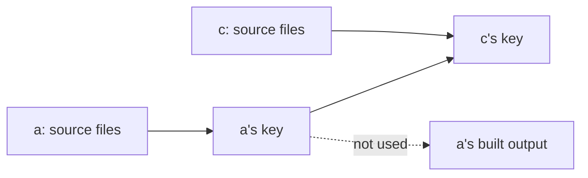

A task's key includes the input keys of its dependencies, never their
outputs. So vx knows every key in the graph before the first task runs.



## The cost: one extra run downstream

```sh frame="terminal"
$ echo "// only a comment" >> packages/a/src/index.ts
$ vx run build --all
 ⏺︎     9ms success miss     packages/a#build
 ⏺︎     8ms success miss     packages/c#build

$ cmp packages/a/dist/index.js /tmp/a-before.js && echo identical
identical

$ vx why packages/c#build
  verdict    cache key changed: upstream packages/a#build
  what changed (1 component, 5 unchanged):
    changed upstream  packages/a#build  8d4c5d7e6e657a9c → 234db6b6c1ccd2b1
```

`a` built the same bytes, and `c` still ran again. Its key moved with
`a`'s inputs. The new output is cached, and narrower inputs keep a
comment out of the key ([key parts](../keys-from-git/)).

<small>Demo workspace · vx `69617eb` · 2026-10-23</small>

## The win: keys before anything runs

| Fold the upstream's…        | A comment-only edit upstream | Key known before anything runs? |
| --------------------------- | ---------------------------- | ------------------------------- |
| output hash (early cutoff)  | downstream hits              | no: needs the upstream to run   |
| input key (vx)              | downstream re-runs once      | yes                             |

Keying on outputs (early cutoff) skips that rerun. But then `c` has no
key until `a` has run.

```sh frame="terminal"
$ echo "// again" >> packages/a/src/index.ts
$ vx run build --all --dry
  ▶  packages/a#build  cache miss — would exec   8844b0fc  ~9ms
  ✓  packages/b#build  cache hit (local)         e8c0e9d5
  ▶  packages/c#build  cache miss — would exec   1c43f07c  ~10ms
  ✓  packages/d#build  cache hit (local)         9f1cef08
```

`c`'s new key is on screen before `a` runs. That gives you real
`--dry` answers, one remote lookup for the whole graph, restores that
fill idle cores, remote execution and `vx why`.

## When a key has to wait

A key waits for its dependencies when one may write a file the task
reads first.

That covers three kinds of upstream:

- an upstream's root-anchored `outputs.workspaceFiles`;
- an upstream with no `cache` block that may write in the project;
- an upstream that rewrites its own inputs in place (a formatter) whose
  key this one does not fold.

That task, and every task depending on it, waits and is left out of the
up-front lookup. `vx lock` refuses a task whose inputs match another
task's outputs.

Full details: [Caching](../../caching/). More at
[vznjs.github.io/vx](https://vznjs.github.io/vx/).
