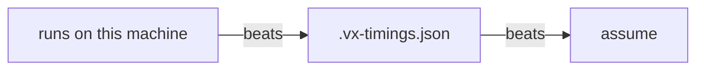

A fresh CI runner doesn't know which tasks are slow, so it can start
them last. One small file carries task times from runner to runner, and
the slow tasks start first.

| Runner | Wall time (min of 3) |
| --- | --- |
| Cold, no file | 12.09 s |
| Cold, with the file | 10.68 s |
| Full local history | 10.64 s |

<small>8 packages with a `build` → `check` → `pack` chain (0.5 s each) and 3 slow `e2e` tasks (10 s each) · `sleep` tasks · linux x64, 4 cores, 4 workers · vx 0.0.634 · `bun private/vx-bench/timings-file-bench.ts`</small>

Every task runs in all three. Only the order changes. The file saves
1.4 s and matches a machine with its full history. No order finishes under 10.5 s.

## Turn it on

```ts title=".vx/workspace.ts"
import { vxHistory } from '@vzn/vx-history'

export default {
  plugins: [vxHistory({ file: '.vx-timings.json' })],
}
```

`@vzn/vx-history` starts the longest chain first. vx reads the
file before it orders the run, and writes each task's median time after:

```json
{
  "version": 1,
  "tasks": {
    "app#build": 41200,
    "app#test": 18350,
    "docs#build": 29010
  }
}
```

## Carry it between runners

```yaml
- uses: actions/cache@v4
  with:
    path: .vx-timings.json
    key: vx-timings-${{ github.run_id }}
    restore-keys: vx-timings-
```

Add the file to `.gitignore`, or a task with `**` inputs gets a new key
each time it changes. vx warns if git doesn't ignore it.



## When it can't help

If one task is the whole wall time, order doesn't matter. vx's own CI
had one 194 s test suite: 194.07 s with the file, 194.60 s without.

A fully cached run doesn't rewrite the file, so it pays nothing extra.

More at [vznjs.github.io/vx](https://vznjs.github.io/vx/).
