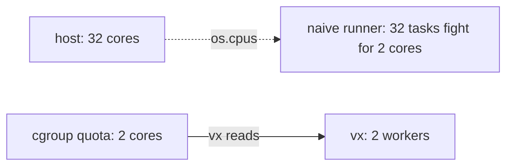

In a container, `os.cpus()` and `os.totalmem()` report the host, not
your limit. vx reads the limit the kernel enforces. In the container
this post was written in:

```sh frame="terminal"
$ bun -e 'console.log((require("os").totalmem() / 2 ** 30).toFixed(1), "GB")'
15.7 GB

$ vx info
  workers           4 — the CPU count
  memory            13 GB usable — cgroup limit; the machine has 16 GB
```

<small>Linux x64, cgroup v1 · vx 69617eb · 2026-10-23</small>

CPUs have the same trap. A CI job with 2 cores on a 32-core host still
reads 32.

A runner that starts 32 tasks there gets 2 cores of work done, slower.
vx shows `workers 2 — cgroup CPU quota 2 of 32 cores`.



## Read the limit the kernel enforces

| cgroup | CPU limit file | Example |
| --- | --- | --- |
| v2 | `cpu.max` | `200000 100000` = 2 cores, `max` = none |
| v1 | `cpu.cfs_quota_us` / `cpu.cfs_period_us` | quota `-1` = none |

A parent cgroup's limit binds too, so vx walks up to the root and keeps
the tightest. It rounds up: a 1.5-core quota gets 2 workers.

Memory works the same way. macOS has no cgroups, so the machine's
numbers stand.

## When you know better

The default is a starting point:

```sh
vx run test --all --concurrency 4     # exactly four
vx run test --all --concurrency 50%   # half the cores, never below one
vx run test --all --concurrency 1     # one at a time, still in graph order
```

`run.concurrency` in `.vx/workspace.ts` sets a default. The flag wins.
Over 100% is allowed for tasks that mostly wait on network or disk.

## Not every task needs a core

- **Cache restores** only copy files. They run on their own lane, up to
  twice the worker count, and never block a task that must run.
- **Remote tasks** count against the remote pool's `capacity`. A
  64-worker pool stays full even from a 10-core laptop.

The details are in [Concurrency](../../execution/#concurrency). More at
[vznjs.github.io/vx](https://vznjs.github.io/vx/).
