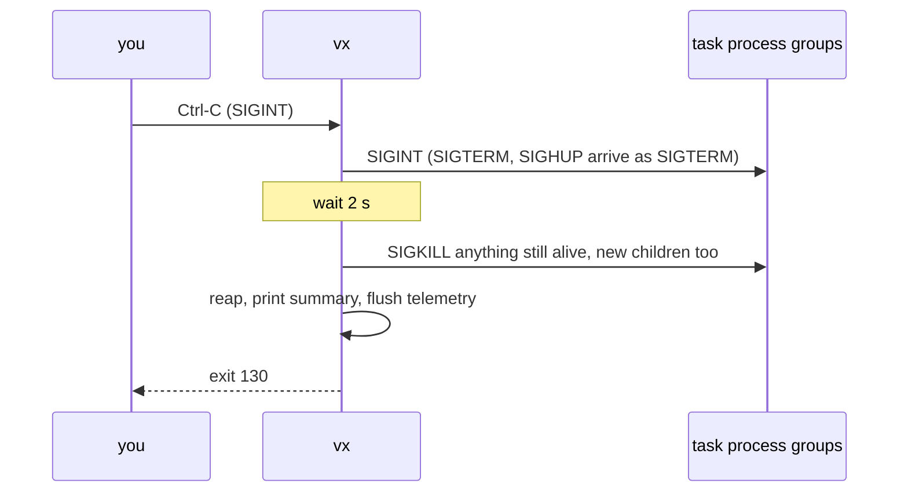

Press Ctrl-C and every process vx started is gone within two seconds.
No `vite` left holding port 5173, no `tsc -w` from last Tuesday.

Here a task starts two background `sleep`s. Shells ignore `SIGINT` in
background jobs, so these two won't stop on Ctrl-C by themselves:

```ts
serve: { exec: { command: 'sleep 301 & sleep 302 & wait' } }
```

| When           | Processes left                         |
| -------------- | -------------------------------------- |
| before Ctrl-C  | 3 (`sh -c …`, `sleep 301`, `sleep 302`) |
| after Ctrl-C   | 0 (vx exits 130 after 2,008 ms)         |

<small>5 runs, 2,008 to 2,011 ms · Linux x64 · vx 0be0367 · 2026-10-23</small>

The two seconds are the grace period. Then vx sends `SIGKILL`.

## The teardown



Each step has a time limit. Nothing is left as a zombie.

A second Ctrl-C skips the wait. A remote cache download in flight is
dropped, not waited on.

| How the run ended                     | Exit code |
| ------------------------------------- | --------- |
| `SIGINT` (Ctrl-C)                     | 130       |
| `SIGHUP` (the terminal closed)        | 129       |
| `SIGTERM` (a CI cancel)               | 143       |
| a foreground persistent task failed   | 1         |

## Every way a run ends goes through it

- **A signal:** `SIGINT`, `SIGTERM` or `SIGHUP`. A task runs in its own
  session, so a closing terminal reaches only `vx`, which passes it on.
- **An abort:** `run()` as a library call takes an `AbortSignal`.
- **A readiness timeout:** a dev server whose `readyWhen` never matched.
- **A dev server exits:** with three up, one exiting stops the others.
- **The normal end:** dev servers that other tasks needed stop when the
  graph is done.
- **`vx watch`:** Ctrl-C mid-cycle stops that cycle's children.

## The tests are the claim

Each path has a test. It starts a real child, ends the run that way,
and checks the child is dead in time. A zombie counts as alive.

A task that calls `vx run` on its own workspace is refused, so two runs
never fight over the same children.

More at [vznjs.github.io/vx](https://vznjs.github.io/vx/).
