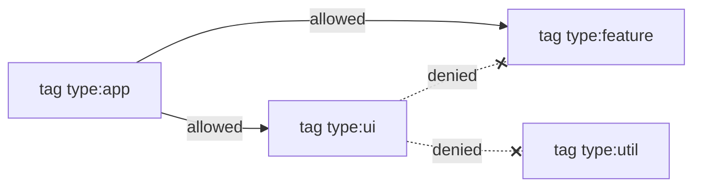

Tag your projects by layer and say which layers may depend on which. `vx
lock` refuses a dependency that breaks a rule.

Here UI may not depend on a utility, and `packages/c` (UI) depends on
`packages/a`:



```ts
// .vx/workspace.ts
import { defineWorkspace } from '@vzn/vx/config'

export default defineWorkspace({
  run: {
    rules: {
      dependencies: [{ from: 'tag:type:ui', deny: ['tag:type:util'] }],
    },
  },
})
```

```sh frame="terminal"
$ vx lock
✗ vx lock  lock not written

  1 dependency breaks run.rules.dependencies
  packages/c depends on packages/a, which run.rules.dependencies[0] (from 'tag:type:ui') denies

  fix  drop the dependency, or change the project's tags or the rule
$ echo $?
1
```

The edge here is a task edge (`c#build` depends on `a#build`), not a
`package.json` dependency. Both count.

<small>Demo workspace · vx 69617eb · 2026-10-23</small>

## Tags and rules

A project names its tags in its own config:

```ts
// packages/button/vx.config.ts
import { defineProject } from '@vzn/vx/config'

export default defineProject({
  tags: ['type:ui'],
  tasks: { build: { exec: { command: 'tsc -b' } } },
})
```

The workspace says what each tag may depend on. A selector is
`tag:<glob>` or a project-name glob:

```ts
// .vx/workspace.ts
import { defineWorkspace } from '@vzn/vx/config'

export default defineWorkspace({
  run: {
    rules: {
      dependencies: [
        { from: 'tag:type:app', allow: ['tag:type:feature', 'tag:type:ui'] },
        { from: 'tag:type:ui', deny: ['tag:type:feature', 'tag:type:app'] },
      ],
    },
  },
})
```

A dependency must match one of `allow` (if given) and none of `deny`.
A deny beats any allow. A project no rule selects is free.

## vx lock checks them, runs don't

`vx lock` checks each project's direct dependencies: `package.json` and
cross-project `dependsOn`. It names every broken edge and writes
nothing. Fix the edge and the lock is written:

```sh frame="terminal"
$ vx lock
✓ vx lock  6 project configs → .vx/projects.lock.json

$ vx lock --check
✓ vx lock --check  up to date (6 projects)
```

`vx lock --check` in CI fails the same way, so a pull request with a
forbidden dependency goes red.

Runs read the lock, which already passed the rules, so they pay nothing
([vx lock](../lock-and-frozen/)).

## From Nx

`nx()` from `@vzn/vx-migrate` reads the `depConstraints` of
`@nx/enforce-module-boundaries` from your ESLint config and fills
`run.rules.dependencies`.

It reads the file without running it, so ESLint never loads on a vx run.

```js
// eslint.config.mjs (Nx)
depConstraints: [
  { sourceTag: 'type:app', onlyDependOnLibsWithTags: ['type:feature', 'type:ui'] },
  { sourceTag: 'type:ui', notDependOnLibsWithTags: ['type:feature'] },
]
```

becomes:

```ts
dependencies: [
  { from: 'tag:type:app', allow: ['tag:type:feature', 'tag:type:ui'] },
  { from: 'tag:type:ui', deny: ['tag:type:feature'] },
]
```

One difference: Nx's [lint
rule](https://github.com/nrwl/nx/blob/master/packages/eslint-plugin/src/rules/enforce-module-boundaries.ts)
checks source imports. vx checks declared dependencies.

`allSourceTags`, `/regex/` tags and external-import bans are left out.
The [vx-migrate
README](https://github.com/vznjs/vx/tree/main/packages/vx-migrate#module-boundaries)
lists them.

The schema is in the [configuration reference](../../schema/). More at
[vznjs.github.io/vx](https://vznjs.github.io/vx/).
