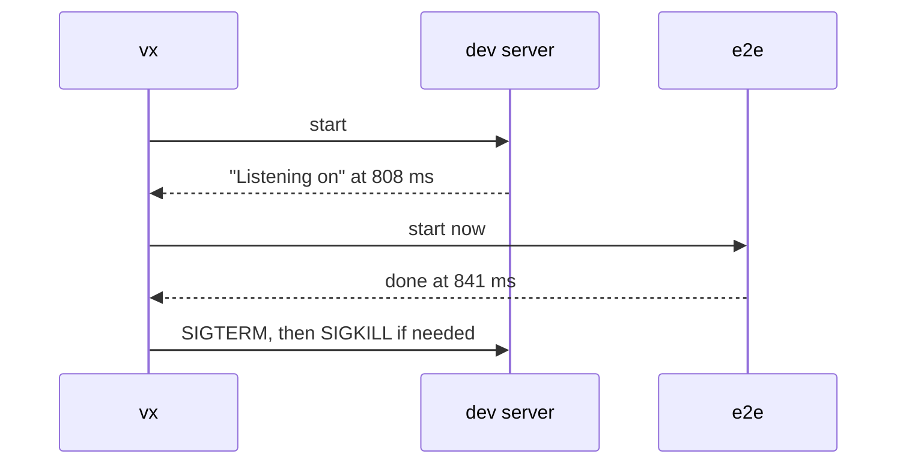

"Start the tests once the server is up" usually ends as a `sleep 5`.
vx waits for the line the server prints instead, and stops the server
when the run ends.

```ts
dev: {
  exec: {
    command: 'bun server.ts', // sleeps 800 ms, then listens on :3999
    persistent: { readyWhen: 'Listening on' },
    timeout: '30s',
  },
},
e2e: {
  dependsOn: ['dev'],
  exec: { command: 'curl -sf localhost:3999' },
},
```

```sh frame="terminal"
$ vx run packages/c#e2e
┌─ packages/c#e2e > $ curl -sf localhost:3999
ok
└─ packages/c#e2e ── (9ms) success
            2 success · 2 total
  time      841ms · max 808ms · avg 409ms · min 9ms

$ curl localhost:3999
curl: (7) Failed to connect to localhost port 3999 after 0 ms: Couldn't connect to server
```



The test started the moment the server was ready. After the run,
nothing listens on the port.

<small>vx 0be0367 · 2026-10-23</small>

## Ready is a line of output

`readyWhen` is a regex run on the task's output. When a line matches,
the tasks waiting on it start. A last line with no newline counts too.

`exec.timeout` limits the wait. If the line never comes, vx kills the
server and fails the task. No polling, no `wait-on`, no guessed seconds.

## The end is guaranteed

When the run ends, each server gets `SIGTERM`, a grace period, then
`SIGKILL`. Nothing keeps a port after `vx run e2e`, whether tests
passed, failed, timed out, or you pressed [Ctrl-C](../ctrl-c/).

## In the foreground

`vx run dev` keeps the server in your terminal. When one of the
servers you asked for exits, vx says which and stops the rest:

```ansi
vx: packages/app#dev exited with code 1; stopping 1 other persistent task
```

A crashed server makes `vx` exit 1.

## What it costs elsewhere

A server runs on this machine, and so does everything that depends on
it, since a remote worker can't reach your laptop's port. A sandboxed
server gets the same walls, but no violation report.

Servers aren't cached. Their dependents can be: `e2e`'s key includes
`dev`'s key, so a server config change runs the tests again. If every
dependent is a cache hit, the server never starts.

Guide: [Dev servers](../../docs/dev-servers/). More at
[vznjs.github.io/vx](https://vznjs.github.io/vx/).
