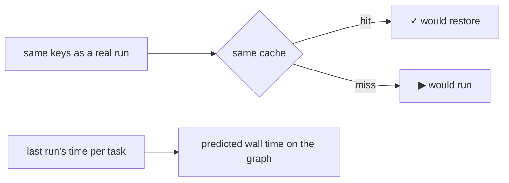

`--dry` shows what the next run will do, without running anything. One
file changed in `packages/b`:

```sh frame="terminal"
$ vx run build test --all --dry
would run:
  ✓  packages/a#build  cache hit (local)         4ab2bc0d
  ▶  packages/b#build  cache miss — would exec   e8c0e9d5  ~19ms
  ✓  packages/c#build  cache hit (local)         5e8ed98e
  ✓  packages/d#build  cache hit (local)         9f1cef08
  ✓  packages/a#test   cache hit (local)         9ea4543b
  ▶  packages/b#test   cache miss — would exec   537a0bf3  ~19ms
  ✓  packages/c#test   cache hit (local)         6c5e8b3a
  ✓  packages/d#test   cache hit (local)         5b407891

8 task(s) planned, 6 cache hits (6 local), 2 would run.
predicted: ~19ms wall · ~38ms total execution

$ vx run build test --all
 ⏺︎    10ms success miss     packages/b#test
 ⏺︎    17ms success miss     packages/b#build
```

The plan said two tasks would run. The run ran those two.

<small>Linux x64 · vx 69617eb · 2026-10-23</small>

## The plan uses the real keys



A hit in the plan is a hit in the run. The time next to a task is its
last run. The prediction lays those times on the graph, so parallel
tasks overlap.

## JSON for scripts and agents

```json
{"id":"packages/a#build","project":"packages/a","task":"build","hash":"4ab2bc0d55dd78a0","cacheStatus":"hit-local","deps":[],"p50Ms":22}
```

`--dry=json` gives one object per task. An agent can check if a run is
worth starting, or show a reviewer what a change rebuilds:

```sh frame="terminal"
vx run build --affected --dry=json
```

## Draw the graph

Each task lists its `deps`, so Graphviz is one `jq` away:

```sh frame="terminal"
vx run build --all --dry=json \
  | jq -r '"digraph G {", (.tasks[] | .id as $t | .deps[] | "  \"\(.)\" -> \"\($t)\""), "}"' > graph.dot
dot -Tsvg graph.dot > graph.svg
```

Reference: [the CLI](../../cli/). More at
[vznjs.github.io/vx](https://vznjs.github.io/vx/).
