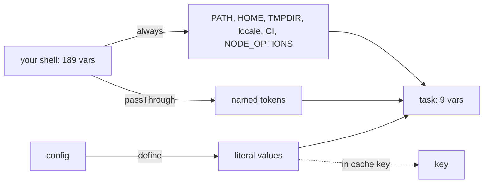

Your shell holds tokens, cloud keys and leftovers. A vx task gets a
short fixed list plus the names you write down.

```sh frame="terminal"
$ env | wc -l
189
$ vx run packages/d#envcount        # command: env | wc -l
9
```

<small>Linux x64 · vx 69617eb · 2026-10-23</small>

```ts
// packages/d/vx.config.ts
import { defineProject } from '@vzn/vx/config'

export default defineProject({
  tasks: {
    env: {
      exec: {
        command:
          'echo "FOO=$FOO" && echo "NODE_ENV=$NODE_ENV" && echo "DEPLOY_TOKEN=$DEPLOY_TOKEN" && echo "GH_PAT=$GH_PAT"',
        env: {
          passThrough: ['DEPLOY_TOKEN', 'GH_PAT'],
          define: { NODE_ENV: 'production' },
          secret: ['GH_PAT'],
        },
      },
    },
  },
})
```

```sh frame="terminal"
$ FOO=leaked DEPLOY_TOKEN=s3cr3t-value-123 GH_PAT=ghp_abcdef123456 vx run packages/d#env
┌─ packages/d#env > $ echo "FOO=$FOO" && echo "NODE_ENV=$NODE_ENV" && echo "DEPLOY_TOKEN=$DEPLOY_TOKEN" && echo "GH_PAT=$GH_PAT"
FOO=
NODE_ENV=production
DEPLOY_TOKEN=***
GH_PAT=***
└─ packages/d#env ── (4ms) success
```

`FOO` never reached the task. `NODE_ENV` came from the config. Both
tokens arrived, and both printed as `***`.

## What gets in



| Layer          | Example                         | In the cache key? |
| -------------- | ------------------------------- | ----------------- |
| always passed  | `PATH`, `HOME`, `TMPDIR`, locale, `CI`, `NODE_OPTIONS` | no |
| `passThrough`  | a token from your environment   | no                |
| `define`       | a literal value in the config   | yes               |

`passThrough` stays out of the key, so a laptop and CI still share
cache hits.

## Secrets print as ***

A name with `TOKEN`, `SECRET`, `KEY`, `PASSWORD`, `PASSWD` or
`CREDENTIAL` in it is masked without asking. `GH_PAT` has none, so it
goes in `secret`.

Masking covers every place vx prints: logs, cache replays, `vx show`,
`vx why`, `vx last`, telemetry and JSON. A value split across two output
chunks is still caught. Split by a pause, it can show on screen, but no
stored copy keeps it.

## When a variable changes the output

Some variables change the build output, like `NODE_OPTIONS` loading a
loader. vx doesn't guess which. Name it, and its value joins the key:

```ts
inputs: { files: ['src/**'], env: ['NODE_OPTIONS'] }, cache: { outputs: { files: ['dist/**'] } }
```

## Hygiene, not a wall

Dropping variables keeps builds the same across machines. It doesn't
stop a task that goes looking, because an unsandboxed task runs as you.

- **Linux:** vx makes itself non-dumpable, so a task can't read vx's
  environment. `VX_DEBUG_DUMPABLE=1` turns that off for debuggers.
- **macOS:** vx blanks the values `ps eww` would show.

To keep a task away from your files, use `exec.sandbox`.

Rules: [schema](../../schema/). More at
[vznjs.github.io/vx](https://vznjs.github.io/vx/).
