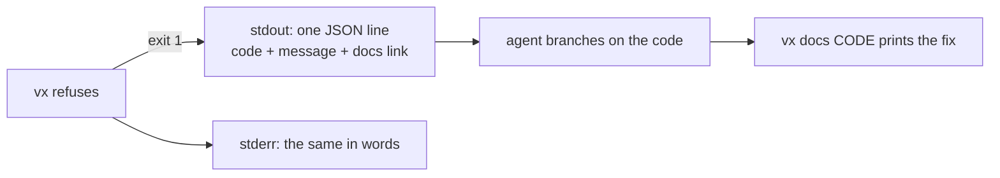

When vx refuses, it gives a stable code and a link to the fix. Your
script or agent checks the code, so it never breaks when the wording
changes.

```sh frame="terminal"
$ vx run biuld --all --dry=json
{"ok":false,"error":{"code":"VX_E_UNKNOWN_TASK","message":"vx run: no projects declare task(s): biuld. Did you mean build?","docs":"https://vznjs.github.io/vx/cli/#vx_e_unknown_task"}}
```



| Code                | Means                                        |
| ------------------- | -------------------------------------------- |
| `VX_E_USAGE`        | A flag or argument vx does not take          |
| `VX_E_UNKNOWN_TASK` | No project declares the task                 |
| `VX_E_CONFIG`       | A config that does not load                  |
| `VX_E_CYCLE`        | The task graph has a cycle                   |
| `VX_E_NO_WORKSPACE` | No workspace above the working directory     |
| `VX_E_LOCK`         | No lock, or one this vx cannot read          |
| `VX_E_REFUSED`      | Any other refusal                            |
| `VX_E_INTERNAL`     | A bug in vx                                  |

`schemas/error.json` describes the line, and the full table is in the
[CLI reference](../../cli/#error-codes).

## Each code says the fix

`vx docs` prints the fix in the terminal, from the docs of your
version:

```sh frame="terminal"
$ vx docs VX_E_UNKNOWN_TASK
── cli.md § VX_E_UNKNOWN_TASK · https://vznjs.github.io/vx/cli/#vx_e_unknown_task

#### `VX_E_UNKNOWN_TASK`

No project in scope declares a requested task. The message lists the
tasks it found; `vx show --format json` lists each project's. …
```

| Code              | The fix says                            |
| ----------------- | --------------------------------------- |
| `VX_E_USAGE`      | the flag it refused; `vx <verb> --help` |
| `VX_E_CONFIG`     | the file and field; `vx docs <field>`   |
| `VX_E_CYCLE`      | the loop; drop one `dependsOn` edge     |
| `VX_E_NO_HISTORY` | run the task once first                 |
| `VX_E_FDS`        | `ulimit -n 4096`, or fewer tasks at once |

Every code has a docs section. A test checks the list against the codes
vx can throw. See the [Agents guide](../../docs/agents/).
