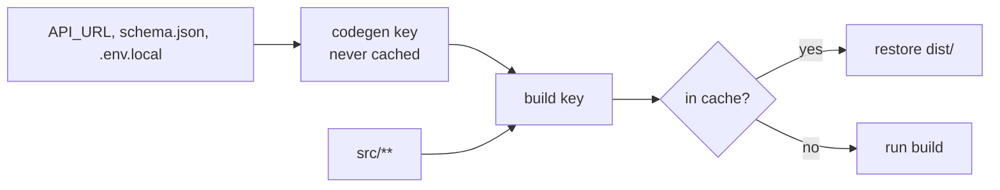

A task you don't cache still has a key. Change a code generator's env,
and the cached build after it runs again.

```ts title="packages/e/vx.config.ts"
import { defineProject } from '@vzn/vx/config'

export default defineProject({
  tasks: {
    codegen: {
      exec: {
        command: 'mkdir -p gen && echo "export const api = \"$API_URL\"" > gen/api.ts',
        env: { passThrough: ['API_URL'] },
      },
      inputs: { files: ['schema.json', '.env.local'], env: ['API_URL'] },
    },
    build: {
      dependsOn: ['codegen'],
      exec: { command: 'mkdir -p dist && cat gen/api.ts > dist/app.js' },
      inputs: { files: ['src/**'] },
      cache: { outputs: { files: ['dist/**'] } },
    },
  },
})
```

```sh frame="terminal"
$ API_URL=https://a.example vx run packages/e#build
  cache     local 1✓ 1∅

$ API_URL=https://b.example vx run packages/e#build
  cache     local 1∅ 1↑
$ cat packages/e/dist/app.js
export const api = https://b.example

$ vx why packages/e#build
  verdict    cache key changed: upstream packages/e#codegen
  what changed (1 component, 3 unchanged):
    changed upstream  packages/e#codegen  35dfe1115aedc6d6 → a7a53dc4d9e0bde9
```

`codegen` never caches (`∅`), but its key goes into `build`'s key. A
new `API_URL` builds again instead of restoring a `dist/` made for the
old one.

<small>Demo workspace · vx 69617eb · 2026-10-23</small>



## Inputs live on the task

`inputs` sits on the task, next to `exec`. It sets the key whether the
task caches or not, as in Turbo and Nx. `cache` holds only `outputs`
and `inputStability`.

A task with a command and no `inputs` has no key. vx won't guess one.
Every task after it runs again and saves nothing:

```sh frame="terminal"
$ vx run packages/e#build      # codegen without inputs
  cache     local 1∅ · 1 not saved
$ vx run packages/e#build
  cache     local 1∅ · 1 not saved
```

A missing input costs a re-run, never a wrong cache hit. Every rule is
on the [Caching](../../docs/caching/) page.

## A gitignored file can still be an input

`.env.local` is gitignored. Editing it still changes the key:

```sh frame="terminal"
$ echo "TOKEN=2" > packages/e/.env.local
$ vx run packages/e#build
  cache     local 1∅ 1↑
```

vx reads tracked files' hashes from git. A path you name outright
(`.env.local`), or a glob whose fixed part git ignores (`gen/**`), is
read from disk.

A broad glob like `src/**` still skips ignored files, and `node_modules`
is never walked.

`--affected` sees only what git sees, as in Nx. An ignored file never
picks a task by itself, but the key still changes when the task runs.

The full key, part by part: [Caching](../../caching/). More at
[vznjs.github.io/vx](https://vznjs.github.io/vx/).
