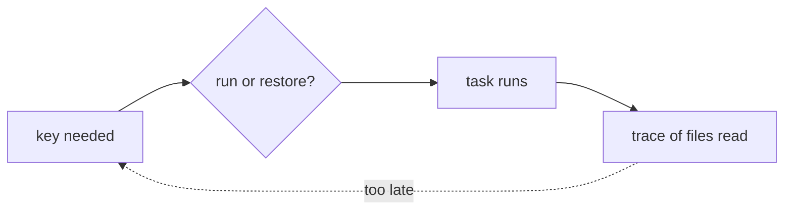

vx never guesses what a task reads. You list its inputs. Here is why:
the worst thing a build cache can do is restore the wrong file. This
task copies `notes.md`, but its inputs name only `src/**`:

```ts
notes: {
  exec: { command: 'mkdir -p out && cp notes.md out/notes.md' },
  inputs: { files: ['src/**'] },
  cache: { outputs: { files: ['out/**'] } },
}
```

```sh frame="terminal"
$ vx run packages/a#notes
            local 1↑
$ cat packages/a/out/notes.md
version 1

$ echo "version 2" > packages/a/notes.md
$ vx run packages/a#notes
            local 1✓
$ cat packages/a/out/notes.md
version 1
```

A green run, a cache hit, and the wrong file. We call that a **stale
hit**. It came from one missing input.

## Why not trace the inputs?



Some tools record the files a task opens. That list can't be the key:

1. **It comes too late.** The key is needed *before* the task runs. A
   trace exists only after.
2. **It sees one path.** A build that reads `config/prod.json` in
   production and `config/dev.json` otherwise has two traces.
3. **Wide defaults rebuild too much.** With `**` as the default, a
   README edit rebuilds every task in the package.

Only the task's author knows what it depends on.

## The two mistakes are not equal

| Mistake                         | What happens                  | Cost                               |
| ------------------------------- | ----------------------------- | ---------------------------------- |
| Extra file listed               | the task runs again           | an extra run: visible, cheap       |
| File missing from the list      | the old output is restored    | a stale hit: green, silent, wrong  |

Tracing makes the second kind, because one run never sees every file a
task can read. Listing inputs lets you err toward the first.

For the second, the [sandbox](../the-sandbox/) helps: give it reads no
wider than the inputs, and the `notes.md` read above fails the run and
names the path.

[`vx why`](../why-did-this-rerun/) explains any re-run.

## Explicit everywhere

- `cache` is opt-in. No block, no cache, no default globs.
- `dependsOn` is explicit. `^task` skips a package without that task.
- Past the essential allowlist every task gets (`PATH`, `HOME`, `CI`,
  `NODE_OPTIONS` and a few more), env reaches a task only through
  `exec.env`.
- A variable that only has to be present goes under `passThrough`. One
  that changes the output also goes under `inputs.env`, which puts it in
  the key.
- The sandbox reads nothing from `cache`. What a task may *touch* and
  what *changes its key* are separate lists.

<small>Demo · vx 0be0367 · 2026-10-23</small>

Write one glob, and skip an afternoon of debugging a stale hit. More at
[vznjs.github.io/vx](https://vznjs.github.io/vx/).
