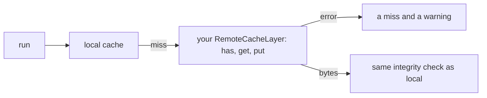

One command writes a working plugin and its test. Fill in one method
and vx does the rest.

```sh frame="terminal"
$ vx init --plugin cache --dry
would write plugins/cache.ts and plugins/cache.test.ts
Declare it in .vx/workspace.ts: import { dirCache } from '../plugins/cache.ts', then plugins: [dirCache(…)]
Test it: bun test plugins/cache.test.ts (needs @vzn/vx installed)
```

Drop `--dry` to write the files.

There is a template for every plugin stage (`executor`, `cache`,
`telemetry`, `schedule`, `admit`, `commands`, `project`, `graph`,
`key`). vx's own CI runs each one, so they keep working.

## A remote cache is three methods



```ts
// plugins/cache.ts
import { link, mkdir, unlink } from 'node:fs/promises'
import path from 'node:path'
import { type ArtifactInfo, definePlugin, type RemoteCacheLayer, type VxPlugin } from '@vzn/vx'

class DirRemote implements RemoteCacheLayer {
  constructor(readonly endpoint: string) {}
  async has(hash: string): Promise<ArtifactInfo | null> {
    const file = Bun.file(path.join(this.endpoint, hash))
    return (await file.exists()) ? { size: file.size } : null
  }
  async get(hash: string) {
    const file = Bun.file(path.join(this.endpoint, hash))
    return (await file.exists()) ? { body: file, durationMs: undefined } : null
  }
  async put(hash: string, body: Blob): Promise<void> {
    await mkdir(this.endpoint, { recursive: true })
    const tmp = path.join(this.endpoint, `.${hash}.${process.pid}`)
    await Bun.write(tmp, body)
    try {
      await link(tmp, path.join(this.endpoint, hash))
    } catch (err) {
      if ((err as NodeJS.ErrnoException).code !== 'EEXIST') throw err
    } finally {
      await unlink(tmp)
    }
  }
}

export function dirCache(dir: string): VxPlugin {
  return definePlugin(import.meta, {
    cache() {
      return new DirRemote(dir)
    },
  })
}
```

A `RemoteCacheLayer` has `has`, `get` and `put`, plus an optional
batched `hasMany`. `put` links the file into place, so a reader never
sees half a file.

Swap the directory for S3, R2 or your own server. vx keeps the local
cache in front and uploads in the background. Give each network call its
own deadline.

## Code before and after the run

`setup(ctx)` runs before the first task and `teardown` after the last.
A `setup` that throws stops the run and names the plugin. A `teardown`
gets 3 seconds.

## Call vx from a script

```ts
// scripts/plan.ts
import { planRun } from '@vzn/vx'

const plan = await planRun({ cwd: process.cwd(), tasks: ['build'], projects: ['packages/c'] })
for (const t of plan.tasks) console.log(t.node.id, t.cacheStatus, t.hash.slice(0, 8))
```

```sh frame="terminal"
$ bun scripts/plan.ts
packages/c#build hit-local aed9a2c6
packages/a#build hit-local 823174d6
```

```sh frame="terminal"
$ bun scripts/plan.ts
packages/c#build hit-local aed9a2c6
packages/a#build hit-local 823174d6
```

<small>Demo workspace · vx `dbe4033` · 2026-10-23</small>

`planRun()` tells you each task's cache status without running it.
`run()` runs them. See the [API reference](../../api/) and
[Plugins](../../modules/plugins/).

More at [vznjs.github.io/vx](https://vznjs.github.io/vx/).
