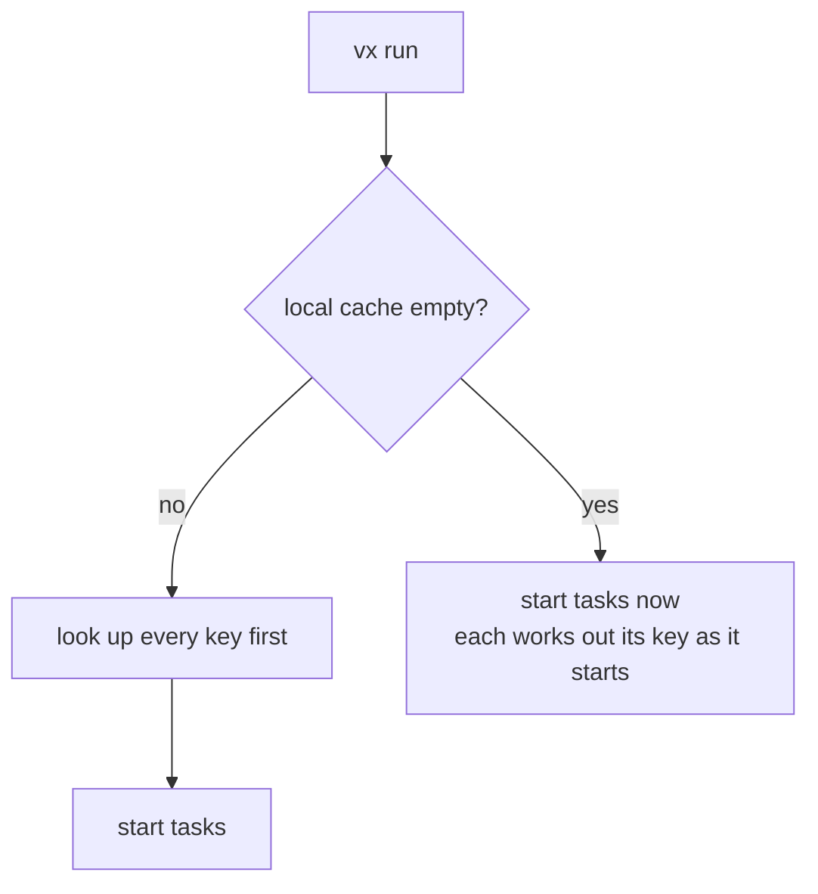

On a cold cache, your first task starts 136 ms after you type `vx run`,
on a 1,000-project workspace.

| Cache before the run | First task starts |
| -------------------- | ----------------- |
| empty                | 136 ms            |
| holds all 1,000 keys | 162 ms            |

<small>Min of 7 runs · `private/vx-bench/generate.ts`, 1,000 projects, `build --all` · Linux x64, 4 cores · vx 13f6908 · 2026-10-23</small>

## Where the wait goes

```sh frame="terminal"
$ VX_DEBUG_TIMING=1 vx run build --all
[vx timing]  stage                    own   cumulative
             startup                 47.9ms      47.9ms
             …
             git enumeration         41.5ms     157.9ms
             classify + probe         9.8ms     168.3ms
             schedule                 0.1ms     168.4ms
             run graph             1855.1ms    2023.5ms
```

`schedule` ends when the first task starts. Everything above it is time
you wait. The lookup step, `classify + probe`, takes 8.8 ms on an empty
cache and 47.3 ms on a full one.

## Why empty is cheaper



With a full cache, looking up every key first is what makes a cached run
fast. With an empty cache every lookup would miss, so vx skips them. The
keys come out the same.

The whole build takes as long as before. You only wait less at the
start.

## Nothing to turn on

```sh
bunx @vzn/vx init
VX_DEBUG_TIMING=1 vx run build --all
```

More at [vznjs.github.io/vx](https://vznjs.github.io/vx/).
