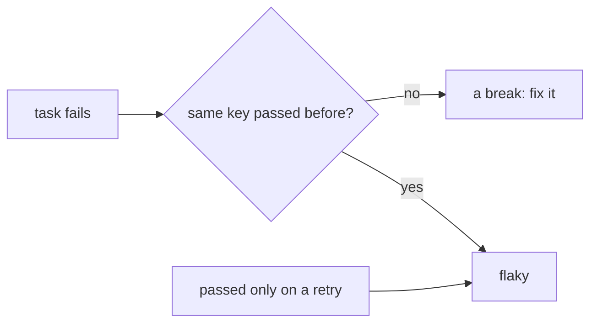

vx calls a task flaky only when the same inputs both passed and failed.
No service needed: your local run history is enough. This task fails,
passes, then fails, on the same inputs:

```ts
flip: {
  exec: { command: 'bun flip.ts' },   // fails when a marker is absent, passes and removes it when present
  inputs: { files: ['flip.ts'] },
  cache: { outputs: { files: [] } },
}
```

```sh frame="terminal"
$ vx run packages/a#flip
└─ packages/a#flip ── (10ms) failed (exit 1)
$ vx run packages/a#flip
└─ packages/a#flip ── (11ms) success
$ vx run packages/a#flip --force
└─ packages/a#flip ── (12ms) failed (exit 1) flaky - passed 1× before
$ vx run packages/a#flip --force
└─ packages/a#flip ── (11ms) success flaky - failed 2× before
```

The first failure isn't flaky: that key had never passed. The second
is, because the same key passed before.

<small>Linux x64 · vx 69617eb · 2026-10-23 · local history only</small>

## When vx says flaky



| Record                              | Verdict          |
| ----------------------------------- | ---------------- |
| key failed, never passed            | a break          |
| key passed after only failures      | a recovery       |
| key failed after it passed          | flaky            |
| passed on a retry                   | flaky            |
| task has no `cache` block           | not judged       |

Without declared inputs, vx can't tell two runs had the same inputs, so
it doesn't judge.

A retry shows the same way:

```sh frame="terminal"
$ vx run packages/a#e2e          # exec.retries: 1
timeout talking to db
vx: retrying packages/a#e2e (attempt 2/2) after exit 1
pass
└─ packages/a#e2e ── (17ms) success flaky - 2 attempts
```

## What you see

The note sits on the task's row:

```ansi
 ◼︎   4.21s                 failed  miss                                  local        app#test flaky - passed 3× before
 ⏺︎  12.84s                 success miss                                  local        api#e2e flaky - failed 1× before · 2 attempts
```

`vx info` lists flaky tasks. `vx last --stats --format json` gives each
a `failureMode`:

```json
{"taskId":"packages/a#flip","runs":4,"successRate":0.5,"failureMode":"flaky-fatal"}
{"taskId":"packages/a#e2e","runs":1,"successRate":1,"failureMode":"flaky-recoverable"}
```

## Why it is free

Every cache entry already records its key and outcome. "Did this key
ever end the other way?" is one lookup. Nothing is uploaded: it reads
the same local `cache.db` as `vx why` and `vx last`.

It works from the second run of a key on your machine. The record lives
under `~/.vx`, so every worktree of the repo shares it.

## What it is not

- **Not a retry policy.** `exec.retries` is separate. A pass on retry
  is *reported*, not quietly made green.
- **Not a quarantine.** Nothing is skipped, because a skip hides a
  failure.

It is a label. What you do about it is up to you. More at
[vznjs.github.io/vx](https://vznjs.github.io/vx/).
