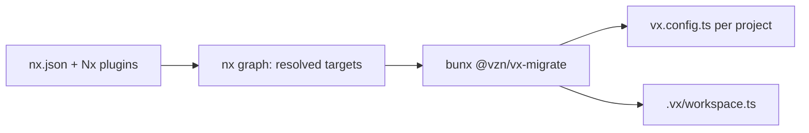

One command writes native vx config from the graph your installed Nx
resolves. Targets that Nx plugins infer come along.

```sh frame="terminal"
$ bunx @vzn/vx-migrate
  from      nx graph
  ran       bun add -d @vzn/vx @vzn/vx-lockfile @vzn/vx-history
  tasks     2 clean
  files     libs/ui/vx.config.ts
            apps/web/vx.config.ts
            .vx/workspace.ts
            .vx/.gitignore
  lock      2 project configs → .vx/projects.lock.json

  next      vx run build --all

$ vx run build --all
 ⏺︎     9ms success miss     ui#build
 ⏺︎     7ms success miss     web#build
$ rm -rf apps/web/dist && vx run build --all
  cache     local 1✓ 1↓
```

<small>Two Nx projects, Nx 24.0.1 · vx-migrate `69617eb` · 2026-10-23</small>

## It reads the graph, not nx.json



```ts title="apps/web/vx.config.ts"
import type { ProjectConfig } from '@vzn/vx/config'

export default {
  tasks: {
    build: {
      exec: {
        command: 'bun build src/index.ts --outdir dist',
      },
      dependsOn: ['^build'],
      inputs: {
        files: ['src/**/*'],
      },
      cache: {
        outputs: {
          files: ['dist'],
        },
      },
    },
  },
} satisfies ProjectConfig
```

`targetDefaults` and `namedInputs` are already applied in the graph, so
each task gets its own values. In vx a shared list is an import.

To check first, `bunx @vzn/vx init --keep` writes only this:

```ts
import type { WorkspaceConfig } from '@vzn/vx/config'
import { nx } from '@vzn/vx-migrate'
import { npm } from '@vzn/vx-lockfile'
import { vxHistory } from '@vzn/vx-history'

export default {
  plugins: [
    nx(),
    npm(),
    vxHistory(),
  ],
} satisfies WorkspaceConfig
```

## Executors become commands, at your pace

```jsonc
{ "build": { "executor": "@nx/js:tsc", "options": { "main": "src/index.ts", "tsConfig": "tsconfig.lib.json" } } }
```

Each becomes an `nx-exec` line that runs the executor through Nx's
public `runExecutor`, so nothing breaks on day one.

An executor target is written as its `nx-exec` line, and you rewrite it
as the real command when you want Nx gone:

```ts
build: {
  exec: { command: 'tsc -b tsconfig.lib.json' },
  inputs: { files: ['src/**', 'tsconfig.lib.json'] }, cache: { outputs: { files: ['dist/**'] } },
}
```

These server executors come through as persistent tasks, and so does
any target Nx marks `continuous`:

- `@nx/vite:dev-server`, `@nx/vite:preview-server`
- `@nx/webpack:dev-server`, `@nx/next:server`
- `@nx/storybook:storybook`, `@nx/web:file-server`
- `@nx/js:node`, `@nx/js:verdaccio`
- `@angular-devkit/build-angular:dev-server`

## What maps

| Nx                                    | vx                                            |
| ------------------------------------- | --------------------------------------------- |
| a project's `targets`                 | `tasks`                                       |
| `dependsOn` (`^build`, …)             | `dependsOn`, same syntax                      |
| `inputs` / `namedInputs` (resolved)   | `inputs.files`                          |
| `{workspaceRoot}/file`                | `inputs.workspaceFiles`                 |
| `outputs`                             | `cache.outputs.files`                         |
| `nx affected`                         | `vx run … --affected[=<base>]`                |
| `nx run-many --projects`              | `vx run … --filter`                           |
| `parallelism: false`                  | a TODO naming `--concurrency 1`               |
| `nx watch`                            | `vx watch`                                    |
| `targetDefaults`                      | already applied in the graph; share them as a preset you import |

## What replaces the rest

| %bench.tasks% tasks, native config | vx | Nx |
| --- | --- | --- |
| Nothing changed | %bench.vx.warm% | %bench.nx.warm% |
| Cold build: CPU the runner burns | %bench.vx.cpu% | %bench.nx.cpu% |

<small>Synthetic monorepo, %bench.projects% projects · concurrency %bench.concurrency% · [benchmarks](../../benchmarks/)</small>

<small>%bench.provenance%</small>

- **The daemon:** vx has [none](../no-daemon/).
- **Distributed task execution:** `@vzn/vx-dte` (alpha) on your own CI
  ([how](../one-run-on-your-own-runners/)), or `@vzn/vx-reapi` on a
  Bazel pool.
- **Remote cache:** `nxCache()` speaks the self-hosted `/v1/cache` wire.
- **Flaky tests:** [from local run history](../flaky-tasks/).
- **Graph view:** `vx run build --all --dry=json` or `vx show`.

Generators have no vx replacement. Guide: [Migrate from
Nx](../../guides/migrate/#nx). More at
[vznjs.github.io/vx](https://vznjs.github.io/vx/).
