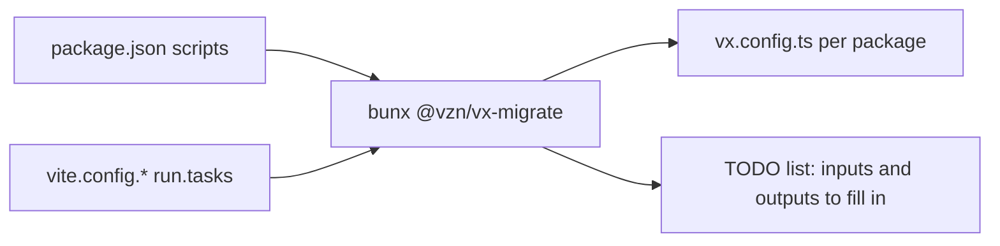

`bunx @vzn/vx-migrate` turns your `package.json` scripts or Vite Task
config into vx tasks. (Coming from [Turbo](../from-turborepo/) or
[Nx](../from-nx/)? They have their own posts.)



## npm hooks keep their order

npm calls `prebuild` before `build` and `postbuild` after it. The
migrator puts the hooks into the task's command, in that order, and
tells you:

```sh frame="terminal"
$ cat packages/app/package.json
{"name":"app","scripts":{"prebuild":"rimraf dist","build":"tsc","postbuild":"node scripts/copy.js"}}

$ bunx @vzn/vx-migrate --dry

─ vx-migrate 0.0.637 ─────────────────────────────────────────
  from      package.json scripts
  dry run   nothing written
  tasks     1 todo
  todo      app#build: npm ran `prebuild` and `postbuild` around this script without being asked; folded into the command in that order
            app#build: cache: add `inputs: { files: ['src/**'] }, cache: { outputs: { files: ['dist/**'] } }` with this package's real inputs and outputs …
```

The chain stops at the first part that fails. Arguments after `--` reach
`build` only, as with npm.

If your package manager skips these hooks (Yarn 2+, or npm with
`ignore-scripts`), each hook stays its own task. Hooks like `prepack`
never become tasks.

## Vite Task

A vite-plus repo keeps tasks in each package's `vite.config.*` under
`run`. The migrator reads them the way `vp run` does:

```sh frame="terminal"
$ bunx @vzn/vx-migrate --from vite-task
```

`command`, `cwd`, `dependsOn` and cache settings map across. A command
starting with `vp run x` becomes a `dependsOn` edge.

Anything that does not map stays in the command with a TODO, so nothing
gets lost.

The full mapping table is in the
[vx-migrate README](https://github.com/vznjs/vx/tree/main/packages/vx-migrate#readme).
More at [vznjs.github.io/vx](https://vznjs.github.io/vx/).
