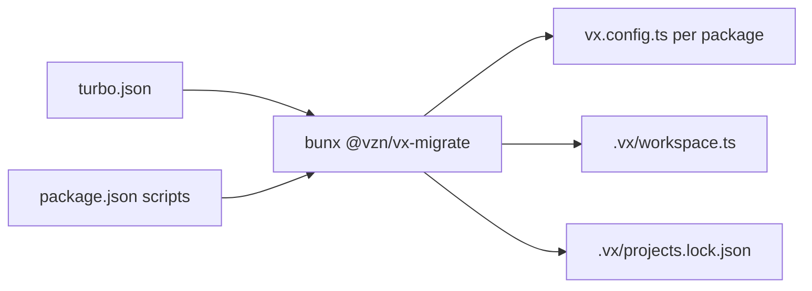

One command turns a Turborepo workspace into native vx config. Five
tasks mapped here, nothing to fix by hand.

```sh frame="terminal"
$ cat turbo.json
{
  "tasks": {
    "build": { "dependsOn": ["^build"], "inputs": ["src/**"], "outputs": ["dist/**"] },
    "test": { "dependsOn": ["build"], "inputs": ["src/**", "test/**"] },
    "dev": { "cache": false, "persistent": true }
  }
}

$ bunx @vzn/vx-migrate
  from      turbo.json
  ran       bun add -d @vzn/vx @vzn/vx-lockfile @vzn/vx-history
  tasks     5 clean
  files     packages/types/vx.config.ts
            packages/ui/vx.config.ts
            packages/web/vx.config.ts
            .vx/workspace.ts
            .vx/.gitignore
  lock      3 project configs → .vx/projects.lock.json

  next      vx run build --all

$ vx run build test --all
 ⏺︎    10ms success miss     ui#build
 ⏺︎     7ms success miss     ui#test
 ⏺︎     6ms success miss     web#build
$ vx run build test --all
  cache     local 3✓
  time      28ms
```

<small>Three-package Turborepo · vx-migrate `69617eb` · 2026-10-23</small>

## What it writes



```ts title="packages/web/vx.config.ts"
import type { ProjectConfig } from '@vzn/vx/config'

export default {
  tasks: {
    build: {
      exec: {
        command: 'bun build src/index.ts --outdir dist',
      },
      dependsOn: ['^build'],
      inputs: {
        files: ['src/**'],
      },
      cache: {
        outputs: {
          files: ['dist/**'],
        },
      },
    },
    test: {
      dependsOn: ['build'],
    },
    dev: {
      exec: {
        command: 'bun --watch src/index.ts',
        persistent: {},
      },
      inputs: {
        files: ['**/*', '!dist/**'],
      },
    },
  },
} satisfies ProjectConfig
```

Each script becomes `exec.command`. A task goes where the script exists,
and to a package without it that another package's `^` task reaches: a
key-only group with no outputs.

So an edit there still reruns its dependants. Anything it cannot map
becomes a `TODO(vx-migrate)` comment. It never overwrites a file without
`--force`.

## Check the mapping first

`bunx @vzn/vx init --keep` writes only a `.vx/workspace.ts` that reads
`turbo.json` through `turbo()`:

```ts
import type { WorkspaceConfig } from '@vzn/vx/config'
import { turbo } from '@vzn/vx-migrate'
import { npm } from '@vzn/vx-lockfile'
import { vxHistory } from '@vzn/vx-history'

export default {
  plugins: [
    turbo(),
    npm(),
    vxHistory(),
  ],
} satisfies WorkspaceConfig
```

When the build matches, `bunx @vzn/vx-migrate` writes the native files.
Both use the same mapper.

## Every key it knows

| `turbo.json`                                   | `vx.config.ts`                                          |
| ---------------------------------------------- | ------------------------------------------------------- |
| `tasks` / `pipeline`                           | `tasks`                                                 |
| `dependsOn`                                    | `dependsOn`, identical syntax                           |
| `inputs` / `outputs`                           | `inputs.files` / `cache.outputs.files`            |
| `env`                                          | `inputs.env` **and** `exec.env.passThrough`       |
| `passThroughEnv`                               | `exec.env.passThrough`                                  |
| `cache: false`                                 | omit the `cache` block                                  |
| `persistent: true`                             | `exec.persistent: {}`, with a TODO to set `readyWhen` when a task depends on it |
| `with` | `dependsOn` a persistent sidecar, started beside the task |
| `interactive: true` | `exec.interactive: true`: the task gets the terminal, alone |
| `extends`                                      | a package task merges over the root's; `false` alone opts out, `false` + keys runs on those alone |
| `interruptible` | nothing: `vx watch` keeps a persistent task up and restarts it only when its config changes or it dies |
| `tags` | nothing: labels Turbo keeps out of the hash and the behaviour |
| `outputLogs` (Turbo 1: `outputMode`)           | no per-task knob: the per-run `--output-logs` flag      |
| `$TURBO_ROOT$/file`                            | `inputs.workspaceFiles`                           |
| `dotEnv` (Turbo 1)                              | `inputs.runtime`: a probe that hashes the `.env` files |
| `command` (Turbo 2.11) | the task's `exec.command`; `null` is no task |
| `description` | the task's `description` |
| `globalDependencies`, `globalEnv`, `globalPassThroughEnv`, `globalDotEnv` | a generated `vx-preset.ts` you import and spread |

Those are every key the mapper knows. Any other key in a task becomes
a TODO naming it, so nothing is dropped silently.

Three things you get that the JSON could not give you:

- **The command is in the config**, where you can read it.
- **Inputs are explicit.** Turbo's default becomes `**/*`, which you can
  narrow and the [sandbox](../the-sandbox/) can check.
- **Presets are imports**, and the key sees them.

## Where vx differs

- `turbo run web#lint build` also runs `web#build` in Turbo. In vx,
  `build` follows the filter and `web#lint` stays put.
- No `--parallel`. Use `--concurrency 1` or
  `--exclude-dependencies[=<names>]`.
- On failure, a vx run with no flag is `deps-ok`: only the failed task's
  dependents skip. `--continue=never` is Turbo's default, and bare
`--continue` is `always`, as in Turbo.

Guide: [Migrate from Turborepo](../../guides/migrate/#turborepo). More
at [vznjs.github.io/vx](https://vznjs.github.io/vx/).
