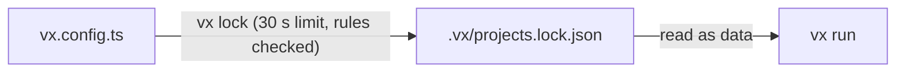

When vx stops something, it names the cause and the fix. Here a
sandboxed task writes one file it wasn't allowed to:

```sh frame="terminal"
$ vx run packages/d#gen
┌─ packages/d#gen > $ mkdir -p dist && echo ok > dist/out.js && echo x > ../shared.txt
/usr/bin/sh: 1: cannot create ../shared.txt: Read-only file system
├─ SANDBOX ───────────────────────────────────────────────────

vx: the sandbox refused writes outside the project, which are not reported as violations: …/demo/packages/shared.txt. If the task needs one, grant its directory, e.g. `allow: { write: ['../'] }`.
└─ packages/d#gen ── (44ms) failed (exit 2)
```

<small>Demo workspace · Linux x64 · vx 69617eb · 2026-10-23 · path shortened</small>

The shell only says "read-only file system". vx names the file and the
line to add to `exec.sandbox`.

## Two tasks, one output folder

vx clears a task's outputs before it runs or restores. Two tasks with
the same output would delete each other's work, so `vx lock` refuses:

```sh frame="terminal"
$ vx lock
✗ vx lock  lock not written

  packages/a#notes and packages/a#slow both write out/** / out/copy.ts
  vx clears a task's outputs before it runs, so one deletes the other's

  fix  give each task its own output path
```

Rules like this are on by default. Turning one off lets vx run that
shape correctly, only slower, and never changes a cache key:

```ts
// .vx/workspace.ts
import { defineWorkspace } from '@vzn/vx/config'

export default defineWorkspace({
  run: { rules: { exclusiveOutputs: false } },
})
```

One check has no switch. A task whose inputs match another task's
outputs can't know its key until that task ends. `vx lock` refuses it
and names the glob to exclude.

## A config that hangs

A `vx.config.ts` is code, and code can hang on a dead server or a
loop. Each config gets 30 seconds, then `vx lock` fails and names it.
`VX_CONFIG_WORKER_TIMEOUT` changes the limit.

## A run never runs a config



A run reads the saved result as data. A config that reads the env or
calls `Math.random` runs once, at lock time. `vx lock --check` tells you
when running it again would give a different answer.

The [schema](../../schema/) lists every rule and sandbox grant. More at
[vznjs.github.io/vx](https://vznjs.github.io/vx/).
