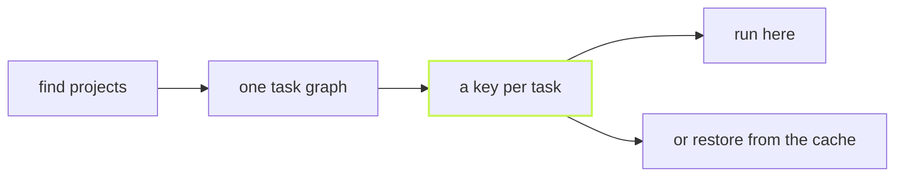

**vx runs and caches a task graph, correctly, and stops there.** It is a
task runner and a content-addressed cache for JavaScript monorepos,
built on Bun. Nothing sits behind a paid cloud.



## Run it twice

Four packages, each with a `build` (`bun build`) and a `test`
(`bun test`). Eight tasks:

```sh frame="terminal"
$ vx run build test --all --force
  tasks     8 success · 8 total
  cache     local 8↑
  time      134ms

$ vx run build test --all
  cache     local 8✓
  time      21ms
```

The second run finds every key in the cache and every output already on
disk, so nothing runs. Timed from outside, start-up included:

```
cold  vx run build test --all --force   min 158.1 ms · median 170.9 ms   (20 runs)
warm  vx run build test --all           min 115.0 ms · median 138.8 ms   (20 runs)
```

Linux x64, 4 cores, Bun 1.4.4, vx from source at `0be0367`, 2026-10-23.
Most of the warm 115 ms is Bun loading vx; the run itself reports 21 ms.

## What is in the box

| Where       | What                                                                     |
| ----------- | ------------------------------------------------------------------------ |
| Core        | graph, keys, scheduler, local cache, running on this machine             |
| Plugins     | remote caches, remote execution, telemetry, CI summaries, lockfile keys |
| Never       | a hosted dashboard, a daemon, a cloud you must buy into                  |

A workspace with no plugins still runs and caches. Each plugin sits on a
documented seam and is declared in `.vx/workspace.ts`.

## Next

- [Quickstart](../../quickstart/): your first cached task, in a repo you
  already have.
- [What vx is, and what it refuses to be](../what-vx-is/).
- [Benchmarks](../../benchmarks/): vx, Turborepo, Nx and Vite Task on
  one graph, each in its own native config.

More at [vznjs.github.io/vx](https://vznjs.github.io/vx/).
