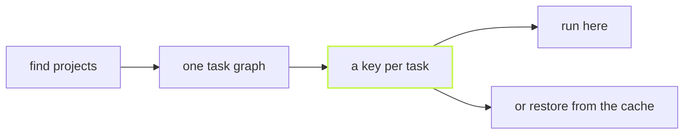

vx runs your monorepo's tasks and caches the results. It is built on
Bun, and nothing sits behind a paid cloud.



## Run it twice

Four packages, each with a `build` (`bun build`) and a `test`
(`bun test`). Eight tasks:

```sh frame="terminal"
$ vx run build test --all --force
  tasks     8 success · 8 total
  cache     local 8↑
  time      134ms

$ vx run build test --all
  cache     local 8✓
  time      21ms
```

The second run finds every result in the cache, so nothing runs.
Timed from outside, start-up included:

| Run  | Command                          | Fastest  |
| ---- | -------------------------------- | -------- |
| cold | `vx run build test --all --force` | 158.1 ms |
| warm | `vx run build test --all`         | 115.0 ms |

<small>Min of 20 runs (median 170.9 ms cold, 138.8 ms warm) · Linux x64, 4 cores, Bun 1.4.4 · vx 0be0367 · 2026-10-23</small>

Most of the warm 115 ms is Bun loading vx. The run itself reports 21 ms.

## What you get, what you don't

| Where       | What                                                                     |
| ----------- | ------------------------------------------------------------------------ |
| Core        | graph, keys, scheduler, local cache, running on this machine             |
| Plugins     | remote caches, remote execution, telemetry, CI summaries, lockfile keys |
| Never       | a hosted dashboard, a daemon, a cloud you must buy into                  |

With no plugins, vx still runs and caches. You add a plugin by naming
it in `.vx/workspace.ts`.

## Next

- [Quickstart](../../quickstart/): your first cached task, in a repo you
  already have.
- [What vx is, and what it refuses to be](../what-vx-is/).
- [Benchmarks](../../benchmarks/): vx, Turborepo, Nx and Vite Task on
  one graph, each in its own native config.

More at [vznjs.github.io/vx](https://vznjs.github.io/vx/).
