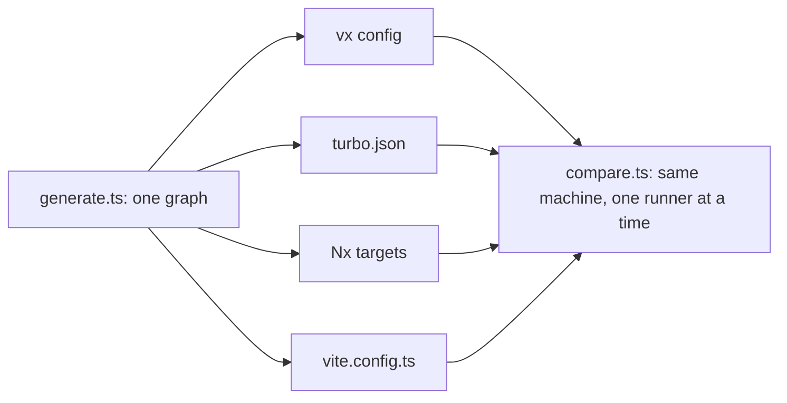

Every number on our benchmark page is one command away. Here is the
time each runner adds on top of the tasks, on one 9,603-task graph:

| Runner    | Cold build overhead | Nothing changed | Cold build CPU |
| --------- | ------------------- | --------------- | -------------- |
| vx        | **7.57 s** | **799 ms** | 36.64 s |
| Turborepo | 9.63 s | 927 ms | 1 min 12 s |
| Nx        | 3 min 6 s | 24.15 s | 5 min 34 s |
| Vite Task | 9.01 s | 12.07 s | 25.32 s |

<small>Synthetic monorepo, 1,601 projects, 9,603 tasks, 30 levels · build 300 ms, test and typecheck 150 ms, lint 75 ms, publish 30 ms · linux x64, 4 cores, concurrency 10 · vx 0be036747, Turborepo 2.11.10, Nx 24.0.1, Vite Task 1.4.0 · 2026-10-23</small>

Lower is better. A cold build's tasks alone take 1 min 53 s with an
ideal schedule. With nothing changed the ideal is 0, so all of that time
is the runner.

No tool wins every row: Vite Task uses the least CPU.

## Re-run it

```sh frame="terminal"
$ bun private/vx-bench/compare.ts 3
```

Every task is a `sleep` of a fixed length, so the numbers measure the
runner, not a compiler. Each runner runs the graph cold, with nothing
changed, and with outputs restored.



| Rule                         | Why                                                   |
| ---------------------------- | ----------------------------------------------------- |
| each tool in its native config | Turborepo `turbo.json`, Nx `nx:run-commands` targets, Vite Task `vite.config.ts` |
| concurrency 10 for all       | same parallelism                                      |
| vx as the compiled binary, from a `vx lock` snapshot | what users install and CI runs |
| CI mode                      | as CI runs them                                       |
| one runner at a time         | no daemon idle-contends for CPU                       |
| no edit row                  | Nx needs its daemon for one, and CI doesn't run it    |

Turbo and Nx run as they would in CI (`CI=1`: Nx's daemon off, and
Turbo uses none for `turbo run`).

## Reading the columns

The first two columns are wall time. The third is the runner's own CPU
time, minus the tasks. A daemon that outlives the run isn't counted, so
Turborepo's and Nx's CPU are lower bounds.

Every row is on [Benchmarks](../../benchmarks/).

## The method

Every change to vx's warm path ships with a number measured like this:
before and after interleaved, fastest of N, "before" built from its own
git worktree.

If a number here doesn't reproduce on your machine, please file a bug.

More at [vznjs.github.io/vx](https://vznjs.github.io/vx/).
