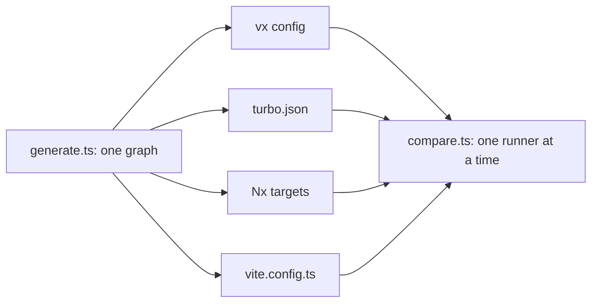

Every number on our benchmark page is one command away. Here is the
time each runner adds on top of the tasks, on one %bench.tasks%-task graph:

| Runner    | Cold build overhead | Nothing changed | Cold build CPU |
| --------- | ------------------- | --------------- | -------------- |
| vx        | %bench.vx.cold% | %bench.vx.warm% | %bench.vx.cpu% |
| Turborepo | %bench.turbo.cold% | %bench.turbo.warm% | %bench.turbo.cpu% |
| Nx        | %bench.nx.cold% | %bench.nx.warm% | %bench.nx.cpu% |
| Vite Task | %bench.vt.cold% | %bench.vt.warm% | %bench.vt.cpu% |

<small>Synthetic monorepo, %bench.projects% projects, %bench.tasks% tasks, %bench.levels% levels · build %bench.task.build%, test and typecheck %bench.task.test%, lint %bench.task.lint%, publish %bench.task.publish% · concurrency %bench.concurrency%</small>

<small>%bench.provenance%</small>

Lower is better. A cold build's tasks alone take %bench.ideal.cold% with an
ideal schedule. With nothing changed the ideal is 0, so all of that time
is the runner.

The table is filled from the latest run when the site is built: each
change to vx re-measures vx, and a new Turborepo, Nx or Vite Task pin
re-measures that tool.

## Re-run it

```sh frame="terminal"
$ bun private/vx-bench/compare.ts 3
```

Every task is a `sleep` of a fixed length, so the numbers measure the
runner, not a compiler. Each runner runs the graph cold, with nothing
changed, and with outputs restored.

The site takes its rows from `vx run @vzn/vx-bench#site.numbers`: one
task per runner, each on a machine of its own.



| Rule                         | Why                                                   |
| ---------------------------- | ----------------------------------------------------- |
| each tool in its native config | Turborepo `turbo.json`, Nx `nx:run-commands` targets, Vite Task `vite.config.ts` |
| concurrency 10 for all       | same parallelism                                      |
| vx as the compiled binary, from a `vx lock` snapshot | what users install and CI runs |
| CI mode                      | as CI runs them                                       |
| one runner at a time         | no daemon idle-contends for CPU                       |
| no edit row                  | Nx needs its daemon for one, and CI doesn't run it    |

Turbo and Nx run as they would in CI (`CI=1`: Nx's daemon off, and
Turbo uses none for `turbo run`).

## Reading the columns

The first two columns are wall time. The third is the runner's own CPU
time, minus the tasks. A daemon that outlives the run isn't counted, so
Turborepo's and Nx's CPU are lower bounds.

Every row is on [Benchmarks](../../benchmarks/).

## The method

Every change to vx's warm path ships with a number measured like this:
before and after interleaved, fastest of N, "before" built from its own
git worktree.

If a number here doesn't reproduce on your machine, please file a bug.

More at [vznjs.github.io/vx](https://vznjs.github.io/vx/).
