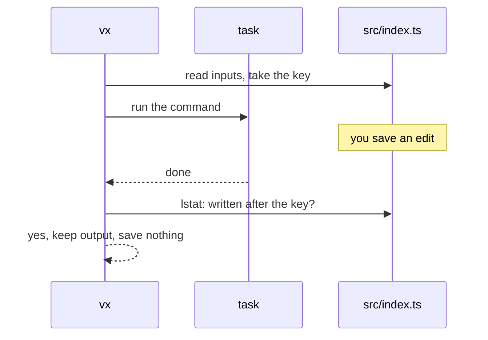

Save a file while a build runs, and vx keeps the result but caches
nothing. A later hit can never bring back output built from the wrong
source.

```sh frame="terminal"
$ (sleep 0.5; echo "// saved mid-build" >> packages/a/src/index.ts) &
$ vx run packages/a#slow
┌─ packages/a#slow > $ sleep 1 && mkdir -p gen && cp src/index.ts gen/copy.ts
[vx] packages/a#slow: `packages/a/src/index.ts` changed after its key was taken — the result stands, but is not saved under a key that no longer describes it; if the task writes it, declare it in cache.outputs
└─ packages/a#slow ── (1.01s) success
  tasks     1 success · 1 total
  cache     1 not saved

$ vx run packages/a#slow
└─ packages/a#slow ── (1.01s) success
  cache     local 1↑
```

<small>Demo workspace · vx `69617eb` · 2026-10-23</small>

The run is green and the output stays. The next run builds again.

## Why it skips the save



The key named the old bytes, and the output came from new ones. Saved
under that key, a later hit would bring back the wrong output. The
check costs one `lstat` per input, only on a miss that saves.

## Same bytes still count

You save an edit mid-build, then undo it. The bytes match again, but the
output was built from the edit. So any write after the key counts,
whatever it holds.

The check is the same on CI, where another task can do the same thing.

## A tool that rewrites its own input

tsdown rewrites `package.json` with the same bytes every build. Tell vx
to compare bytes for that task:

```ts
build: {
  exec: { command: 'tsdown' },
  inputs: { files: ['src/**', 'package.json'] },
  cache: {
    outputs: { files: ['dist/**'] },
    inputStability: { strategy: 'mutable' },
  },
},
```

| Setting | Does |
| --- | --- |
| `strategy: 'mutable'` | compares bytes, not write times |
| `strategy: 'unchecked'` | no check |
| `severity: 'error'` | fails the task instead of warning |

The env vars `VX_CACHE_INPUT_STABILITY_STRATEGY` and
`VX_CACHE_INPUT_STABILITY_SEVERITY` set the default.

A failed task's line names the file, and `vx last --failed --format
json` reports `inputMoved`. If the file is generated, declare it as an
output.

## Downstream skips the save too

Every task that ran over those outputs saves nothing either. You pay one
rebuild, and every saved entry means what its inputs say. Details:
[Caching](../../caching/).

More at [vznjs.github.io/vx](https://vznjs.github.io/vx/).
