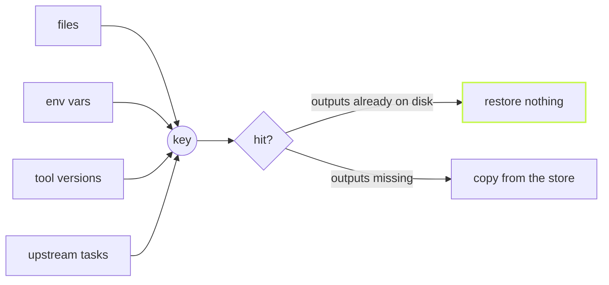

A cache is only as good as two lists: what goes into the key, and what
comes back on a hit. You write both down. vx checks each end.



## What goes in

```ts
// packages/api/vx.config.ts
import { defineProject } from '@vzn/vx/config'

export default defineProject({
  tasks: {
    bundle: {
      exec: {
        command: 'vite build',
        env: { passThrough: ['NODE_ENV'] },
      },
      inputs: {
        files: ['src/**'], // required: this project's files
        env: ['NODE_ENV'], // values folded into the key
        runtime: ['bun --version'], // a command's output, folded in
        workspaceFiles: ['tsconfig.base.json'], // root files, by name
      },
      cache: {
        outputs: { files: ['dist/**'] },
      },
    },
  },
})
```

`files` globs stay inside the project. A shared root file goes in
`workspaceFiles` by name. `inputs.tasks` picks which upstream tasks'
keys count.

A var in the key isn't the same as a var the task sees. List it in
both, as above. Change it and the key changes:

```sh frame="terminal"
$ NODE_ENV=production vx run packages/api#bundle
bundling for production
└─ packages/api#bundle ── (6ms) success

$ NODE_ENV=production vx run packages/api#bundle
bundling for production
└─ packages/api#bundle ── (3ms) up-to-date

$ NODE_ENV=development vx run packages/api#bundle
bundling for development
└─ packages/api#bundle ── (5ms) success
```

## What comes back

A hit prints stdout and stderr in the order the task printed them, so a
warning shows where it did the first time:

```sh frame="terminal"
$ vx run packages/api#bundle
┌─ packages/api#bundle > $ echo "bundling for $NODE_ENV"; echo "warn: large chunk" >&2; …
bundling for production
warn: large chunk
└─ packages/api#bundle ── (3ms) up-to-date
```

If the outputs on disk already match, vx restores nothing. It checks a
few file stats and moves on. Delete one project's `dist` and only that
one comes back:

```sh frame="terminal"
$ vx run build --all
  cache     local 4✓
  time      10ms

$ rm -rf packages/c/dist && vx run build --all
  cache     local 3✓ 1↓
  time      21ms
```

Restores run on their own lane, so they never wait behind compilers.

## A damaged download is a miss

Every archive vx uploads ends with a CRC-32 checksum and its own key.
Tar checks only its headers, and zstd can decode a flipped byte in an
image without error. So vx checks the sum first.

A wrong sum, wrong key, or a file outside the declared outputs turns the
hit into a miss, and the task runs.

Local hits are vx's own files, copied out unchecked ([A cache hit is a
file copy](../a-hit-is-a-file-copy/)).

## Uploads never hold the run

The local save is immediate. The upload runs in the background, and
dependents start at once. vx finishes uploads before it exits. A failed
upload is a warning, never a red build.

<small>One-project workspace for `bundle`, four-project demo for `build` · vx dbe4033 · 2026-10-23</small>

The full rules are in [Caching](../../caching/) and the
[schema](../../schema/). More at
[vznjs.github.io/vx](https://vznjs.github.io/vx/).
