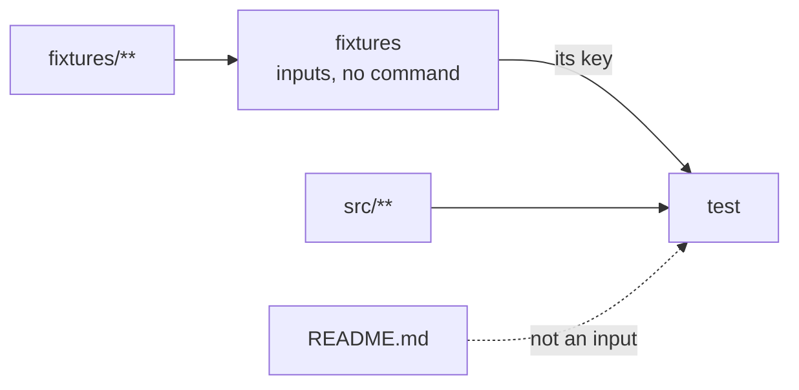

Test fixtures change, but no command builds them. Give them a task with
`inputs` and no command, and `test` runs again when a fixture changes.

```ts title="packages/b/vx.config.ts"
import { defineProject } from '@vzn/vx/config'

export default defineProject({
  tasks: {
    fixtures: { inputs: { files: ['fixtures/**'] } },
    test: {
      exec: { command: 'bun test' },
      dependsOn: ['fixtures'],
      inputs: { files: ['src/**'] },
      cache: { outputs: { files: [] } },
    },
  },
})
```

```sh frame="terminal"
$ vx run packages/b#test
  tasks     1 success · 1 total
  cache     local 1✓

$ echo '{"user":"grace"}' > fixtures/user.json
$ vx run packages/b#test
  tasks     1 success · 1 total
  cache     local 1↑

$ echo "# readme" > README.md
$ vx run packages/b#test
  tasks     1 success · 1 total
  cache     local 1✓
```

A fixture edit runs `test` again (`1↑`: ran and saved). A README edit
is a cache hit. It says `1 total` because `fixtures` started no process.

<small>Linux x64 · vx 69617eb · 2026-10-23</small>

## How the key flows



We call this a keyed group: `inputs` with no `exec`. It takes no
`cache`, because it writes nothing. `--affected` follows it like any
other dependency.

## Migrations use it too

Nx keys a task on its dependencies' `production` files even with no task
edge between them. Turbo hashes a transit node per package.
`@vzn/vx-migrate` writes each as a keyed group, with no processes.

On TanStack/query, `vx run build` counts 25 tasks, as Nx does.

More at [vznjs.github.io/vx](https://vznjs.github.io/vx/).
