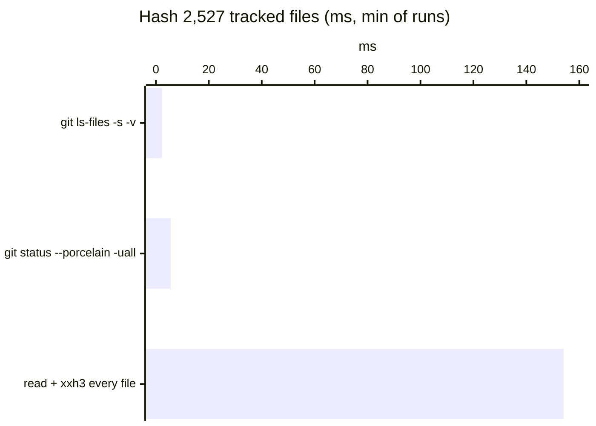
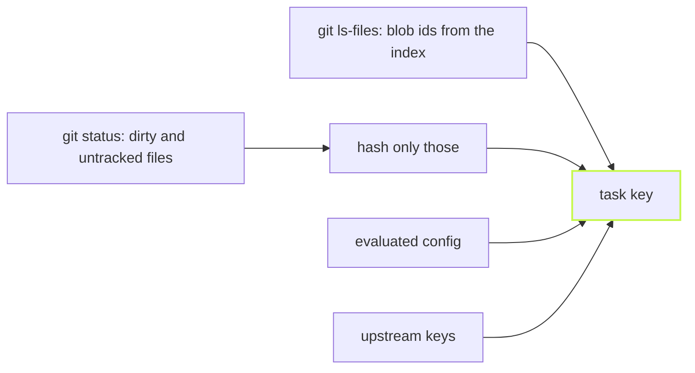

vx hashes your inputs without reading them. Git already stored a hash
for every tracked file.



<small>This repository, 48 MB · linux x64, 4 cores, warm page cache · 2026-10-23</small>



## A key has eleven parts

A key is an xxh3 hash, seed-chained across eleven parts.

Each part goes in under its own label (`task:`, `config:`, `upstream:`,
`plugin:`, `inputs:`, …), with lengths and `\0` separators so two
layouts never collide.

The parts, as [Caching](../../caching/) numbers them:

1. The key-derivation sentinel (`CACHE_VERSION`), so a change to how
   keys are derived is never served by an older entry.
2. The task id, `project#task`.
3. The **evaluated task config**, not its source text
   ([its own post](../resolved-config-hashing/)).
4. Arguments forwarded after `--`.
5. The values of the env vars in `inputs.env`.
6. The output of each `inputs.runtime` command (`node --version`, say).
7. The same for `workspaceRuntime`, run once per run.
8. The keys of the upstream tasks this task depends on
   ([cascade post](../cascade-through-inputs/)).
9. What a plugin's `key` stage adds, folded right after the upstream
   keys and before the input files. `@vzn/vx-lockfile` folds each
   project's dependency closure here.
10. The platform, only for a task that names `exec.platforms`.
11. The content hashes of every file `inputs.files` matches: its git blob
    id, plus its mode for an executable or a symlink, and for a symlink
    what it points to.

Part 11 is where the money is: hundreds of files per package, hundreds
of packages.

## vx asks git once

One `git ls-files -s -v` reads every path and its blob id from the
index. One `git status --porcelain -uall` beside it lists dirty and
untracked files.

An index id is trusted only when it matches the disk, so four prunes run
against it:

1. a dirty path;
2. a `skip-worktree` or `assume-unchanged` path;
3. a path a clean filter could rewrite;
4. an id whose blob is not the size the index recorded for the file.

A repo whose config weakens git's stat check (`core.trustctime=false`,
`core.checkStat=minimal`) trusts no index id at all. Pruned files are
hashed the way git would hash them.

Finding clean filters costs one `git var -l` and a stat per attributes
file.

## A commit never changes a key

```sh frame="terminal"
$ vx run build --all          # after editing packages/a
 ⏺︎    10ms success miss     packages/a#build
 ⏺︎     7ms success miss     packages/c#build
            local 2✓ 2↑

$ git commit -am edit && vx run build --all
            local 4✓
```

<small>Demo workspace · vx `dbe4033` · 2026-10-23</small>

A dirty file gets the blob id git gives it on commit. So after the
commit, everything hits.

## What the key leaves out

| Not in the key           | Why                                                                        |
| ------------------------ | -------------------------------------------------------------------------- |
| `exec.env.passThrough`   | A `HOME` or `CI` that differs per machine would split a shared cache.      |
| Undeclared tool versions | Add `node --version` under `inputs.runtime` when it matters.               |
| `exec.remote`            | Where a task ran says nothing about what it made.                          |
| `.vx/projects.lock.json` | `vx lock` itself must not re-key the world.                                |
| Ignored files            | `src/**` skips them. Name one outright (`.env.local`) to hash it.          |

A variable that changes the output goes under `inputs.env`. A shared
root file goes under `inputs.workspaceFiles`. When a key changes, [`vx
why`](../why-did-this-rerun/) names the part.

More at [vznjs.github.io/vx](https://vznjs.github.io/vx/).
