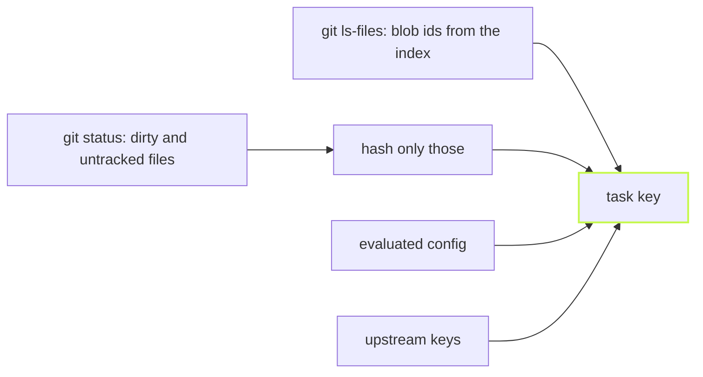

Every build cache has to hash its inputs. vx doesn't read your files to
do it. Git already did.

```
git ls-files -s -v                           min 2.3 ms   (20 runs)
git status --porcelain -uall                 min 5.6 ms   (10 runs)
read + xxh3 every tracked file yourself      min 154.1 ms (10 runs)
```

This repository: 2,527 tracked files, 48 MB. Linux x64, 4 cores, warm
page cache, 2026-10-23.



## What goes into a key

A vx cache key is an xxh3 hash, seed-chained across eleven parts:
each part folds into the running digest under its own label
(`task:`, `config:`, `upstream:`, `plugin:`, `inputs:`, …). Every list
of pairs folds its length first and splits name from value with a `\0`,
so two layouts of the same bytes can't collide. Bun's xxh3 reads only 32
bits of a seed, so each step feeds the seed forward and the chain keeps
all 64 bits. The parts, as [Caching](../../caching/) numbers them:

1. The key-derivation sentinel (`CACHE_VERSION`), so a change to how
   keys are derived is never served by an older entry.
2. The task id, `project#task`.
3. The **evaluated task config**, not its source text
   ([its own post](../resolved-config-hashing/)).
4. Arguments forwarded after `--`.
5. The values of the env vars in `inputs.env`.
6. The output of each `inputs.runtime` command (`node --version`, say).
7. The same for `workspaceRuntime`, run once per run.
8. The keys of the upstream tasks this task depends on
   ([cascade post](../cascade-through-inputs/)).
9. What a plugin's `key` stage adds, folded right after the upstream
   keys and before the input files. `@vzn/vx-lockfile` folds each
   project's dependency closure here.
10. The platform, only for a task that names `exec.platforms`.
11. The content hashes of every file `inputs.files` matches: its git blob
    id, plus its mode for an executable or a symlink, and for a symlink
    what it points to.

Part 11 is where the money is. A real package's build reads hundreds of
files, and a workspace has hundreds of packages.

## Ask git, once

Git stores a content hash for every tracked file: the blob id in the
index. vx runs one `git ls-files -s -v` for the whole workspace. It
reads only the index and returns every path, its blob id and its
cache-state flag. One `git status --porcelain -uall` runs beside it and
says which tracked files differ and what is untracked.

An index id is trusted only where git stores the worktree bytes as they
are, so four prunes run against it:

1. a dirty path (from status);
2. a `skip-worktree` or `assume-unchanged` path, whose id says nothing
   about the disk;
3. a path a clean filter could rewrite;
4. an id whose blob is not the size the index recorded for the file.

A repository whose config weakens the stat git judges by
(`core.trustctime=false`, `core.checkStat=minimal`) trusts no index id
at all. Every pruned or untracked path is hashed in-process with git's
own blob-id algorithm (`blob <size>\0<bytes>`, SHA-1, or SHA-256 in a
SHA-256 repository).

Clean filters (`text`, `eol`, `ident`, `filter`,
`working-tree-encoding`, `core.autocrlf`) store a normalised blob while
your build reads different bytes. The check costs a repository with
none of them one `git var -l` and a stat of each attributes file.

## A commit never changes a key

A dirty file is hashed to the same blob id git gives it on commit. So
edit, run, commit, run misses once (`a` and `c`, which depends on it), then
hits:

```sh frame="terminal"
$ vx run build --all          # after editing packages/a
 ⏺︎    10ms success miss     packages/a#build
 ⏺︎     7ms success miss     packages/c#build
            local 2✓ 2↑

$ git commit -am edit && vx run build --all
            local 4✓
```

A tool that hashes mtimes, or keeps its own fingerprint store, misses
again at the commit, or needs a daemon to avoid it. Demo workspace, vx
at `dbe4033`, 2026-10-23.

## What the key ignores, on purpose

| Not in the key           | Why                                                                        |
| ------------------------ | -------------------------------------------------------------------------- |
| `exec.env.passThrough`   | A `HOME` or `CI` that differs per machine would split a shared cache.      |
| Undeclared tool versions | Add `node --version` under `inputs.runtime` when it matters.               |
| `exec.remote`            | Where a task ran says nothing about what it made.                          |
| `.vx/projects.lock.json` | `vx lock` itself must not re-key the world.                                |
| Ignored files            | `src/**` skips them. Name one outright (`.env.local`) to hash it.          |

If a variable changes the output, list it under `inputs.env`. Globs stay
inside the project; `inputs.workspaceFiles` names files at the workspace
root, like a shared `tsconfig.base.json`.

When a key does change, [`vx why`](../why-did-this-rerun/) names the
part that moved. The full derivation is in [Caching](../../caching/).
More at [vznjs.github.io/vx](https://vznjs.github.io/vx/).
