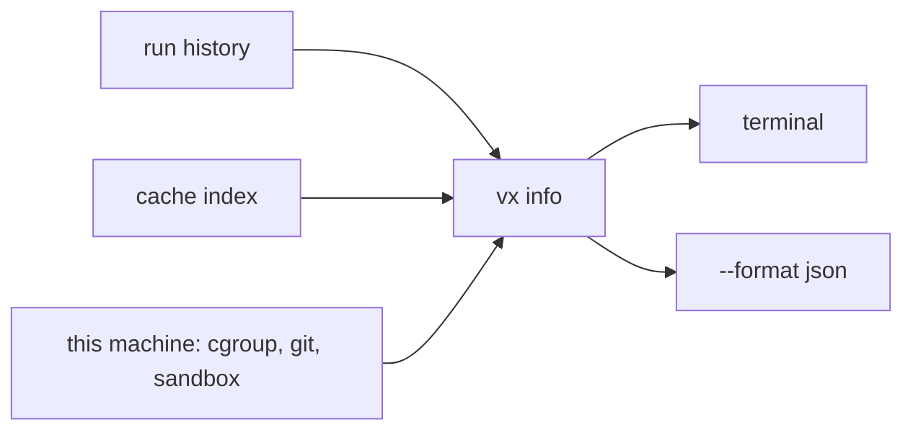

Every bug report starts with the same questions. `vx info` answers them
on one screen.

```sh frame="terminal"
$ vx info

─ vx info ────────────────────────────────────────────────────
  vx                0.0.0
  bun               1.4.4
  git               2.43.0
  git status cache  core.fsmonitor, core.untrackedCache off
  projects          4 (18 tasks)
  plugins           none
  workers           4 — the CPU count
  memory            13 GB usable — cgroup limit; the machine has 16 GB
  cache dir         .vx/cache (242 KB, this workspace's run history)
  cache store       ~/.vx/3c8e043b65dcb173/cache (164 KB, shared by this repo's checkouts)
  cache versions    keys vx-cache-v49 · index schema v49
  cache entries     18 (5.8 KB)
  task runs (24h)   61 (40 cache hits: 40 up-to-date, 0 restored)
  flaky tasks       2 — packages/a#flip (2 of 4 runs failed on unchanged inputs); packages/a#e2e (1 of 2 runs failed)
  sandbox           available (1 task declares exec.sandbox)
  projects lock     yes
```

<small>Demo workspace · Linux x64 · vx 69617eb · 2026-10-23 · paths shortened</small>

## Where each answer comes from



Nothing is uploaded and nothing is recomputed. `memory` is the
container's limit, not the machine's. `flaky tasks` comes from your
local runs ([flaky](../flaky-tasks/)).

`--format json` gives an agent the same facts.

## Keep the cache small

No run deletes cache entries. Trim it by hand or on a schedule, and
look first:

```sh frame="terminal"
$ vx cache clean --max-size 4KB --dry
› vx cache clean  would free 1.9 KB (dry run)

  5 entries
```

Reference: [the CLI](../../cli/). More at
[vznjs.github.io/vx](https://vznjs.github.io/vx/).
