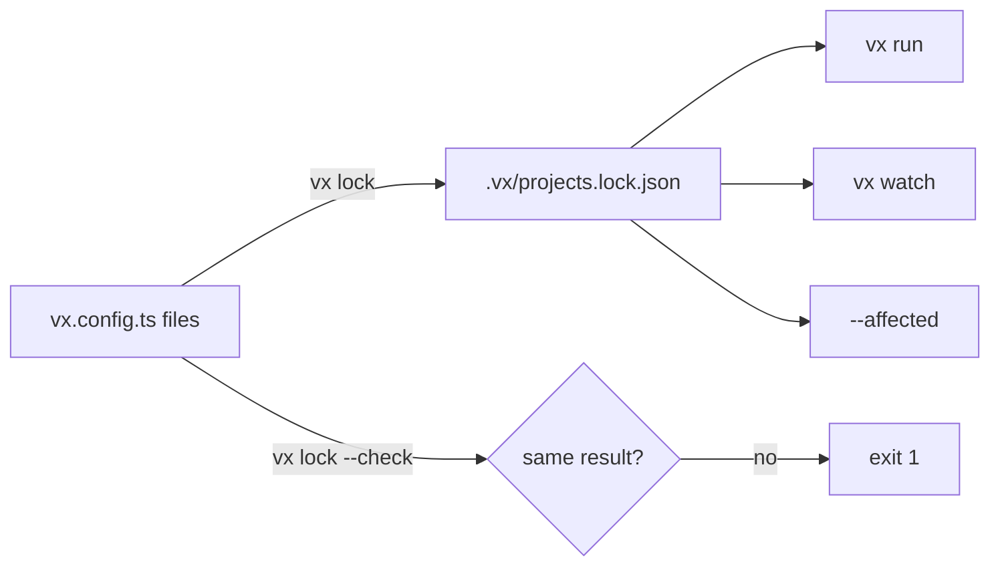

`vx lock` runs every config once and saves the result. Every run reads
that file, so CI runs the config your reviewer saw. A TypeScript config
can depend on where it runs:

```ts
exec: { command: `bun build src/index.ts --outdir dist --minify=${process.env.MINIFY ?? 'false'}` },
```

The file doesn't change when `MINIFY` does. `vx lock --check` still
catches it:

```sh frame="terminal"
$ vx lock
✓ vx lock  4 project configs → .vx/projects.lock.json

$ vx lock --check
✓ vx lock --check  up to date (4 projects)

$ MINIFY=true vx lock --check
✗ vx lock --check  packages/d/vx.config.ts evaluates differently from the lock here — its config, a file it imports, or the environment it reads changed; run 'vx lock'
$ echo $?
1
```

## Lock once, read everywhere



`vx lock` is the only command that runs a config. It also checks the
graph rules. With no lock, a run stops:

```sh frame="terminal"
$ vx run build --all
✗ vx run  no lock: run `vx lock`
```

A project with no `vx.config.*`, whose tasks come from a plugin like
`turbo()`, has nothing to lock. Its tasks load on every run.

## The check a file hash can't do

`--check` runs every config again and compares. It catches edits, and
also an env value, a changed preset import or a computed command.

On this repo (12 projects) it takes 170 ms (min of 10, linux x64,
2026-10-23).

In CI:

```bash
vx lock --check && vx run ci --all
```

A pull request that changes a config without running `vx lock` fails
the first command.

## What the lock is not

| Not…                           | Because                                                                 |
| ------------------------------ | ----------------------------------------------------------------------- |
| a cache key input              | `vx lock` must not change every key.                                    |
| a substitute for `inputs.env`  | The lock saves config-time values. Run-time env goes in the key.        |

## For agents

`vx lock --check --format json` gives the same exit code:

```json
{"upToDate":false,"audited":4,"notAudited":0,"problems":["packages/d/vx.config.ts evaluates differently from the lock here — its config, a file it imports, or the environment it reads changed; run 'vx lock'"]}
```

Same idea as `--frozen-lockfile` in package managers. Reference: [`vx lock`](../../cli/lock/). More at
[vznjs.github.io/vx](https://vznjs.github.io/vx/).
