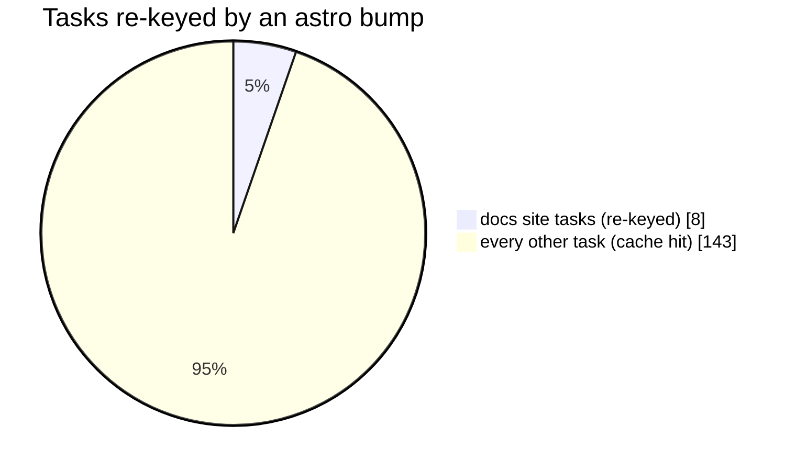

With `@vzn/vx-lockfile`, a lockfile bump rebuilds only the projects
that can reach the bumped package. Bump `astro` in this repo's
`bun.lock`:

```sh frame="terminal"
$ sed -i 's/"astro@7.3.3"/"astro@7.3.4"/' bun.lock
$ vx run ci --all --dry=json | jq … | diff before -
8 of 151 tasks re-key:
  @vzn/vx-docs#build  #build.images  #ci  #import
  @vzn/vx-docs#lint   #lint.oxfmt    #lint.oxlint  #test
```



<small>`bun()` from `@vzn/vx-lockfile` · Linux x64 · vx 69617eb · 2026-10-23</small>

Core keys no lockfile. Without a lockfile plugin, an install changes no
key and an old build gets restored. Putting the whole lockfile in every
key is correct but rebuilds everything on any bump.

(Turborepo keys each package on the lockfile changes that reach it.)

## Key each project on what it can reach

`@vzn/vx-lockfile` has one plugin per package manager: `pnpm()`,
`bun()`, `npm()`, `yarn()`. Each adds to every task's key a hash of
**what its project's `node_modules` can resolve**:

```ts
// .vx/workspace.ts
import { defineWorkspace } from '@vzn/vx/config'
import { pnpm } from '@vzn/vx-lockfile'

export default defineWorkspace({ plugins: [pnpm()] })
```

`vx why` names it as `plugin @vzn/vx-lockfile/pnpm` for the projects an
edit reaches. What counts:

- all its dependencies, followed through the lockfile;
- each package's name, version **and peers** (`foo@1(react@18)` and
  `foo@1(react@19)` are different folders), integrity and patches;
- a `workspace:` dependency brings that package's dependencies too;
- install-wide settings, like the lockfile version;
- the root package's dependencies, in every project, since root tools
  are on every task's PATH.

`bun()`, `npm()` and `yarn()` do the same for their layouts. Yarn
classic has no per-workspace data, so every project gets one root hash.
A package you import but never declared is in no list.

Declare it.

## `--affected` follows the same claim

`vx run test --affected` with a lockfile change picks only the projects
the change reaches. Keys and selection use the same rule, so they never
disagree.

## Measured in the repository that ships it

As above, bumping `astro`, which only the docs site reaches, re-keys 8
of the 151 tasks in `vx run ci --all`.

The root's dependencies are in every key. This repo's root links seven
of its packages as devDependencies, so bumping `protobufjs` (reached
through `@vzn/vx-reapi`) re-keys every task, all 151.

A bump costs what it touches.

Lockfile parsers live in a plugin because they change when package
managers do. Guide: [Lockfiles](../../docs/lockfiles/). More at
[vznjs.github.io/vx](https://vznjs.github.io/vx/).
